# Gamota · Hệ thống Nghiên cứu Thị trường Game có Căn cứ (Evidence-Grounded Market Research MVP)

**Mô tả 1 câu:** Công cụ nghiên cứu thị trường game tự động phân rã câu hỏi kinh doanh, thu thập và xếp hạng nguồn (`A/B/C`), ép buộc xác minh từng câu trích dẫn nguyên văn bằng thuật toán (`RapidFuzz >= 90`) kèm link tô sáng tận nguồn (`#:~:text=`), tính điểm độ tin cậy (`CAO / TRUNG BÌNH / THẤP`) bằng quy tắc code tất định, đồng thời định lượng ảnh hưởng của dữ liệu cũ (`> 18 tháng`) và tự động làm mới có mục tiêu để hỗ trợ ra quyết định phát hành game tại Gamota.

- **Link Demo (Streamlit Cloud):** [https://gamota-market-research-mvp.streamlit.app](https://gamota-market-research-mvp.streamlit.app) *(Nếu ứng dụng đang ở trạng thái ngủ khi mở bằng trình duyệt ẩn danh, vui lòng bấm **"Yes, get this app back up!"** và chờ khoảng 1 phút)*
- **Link Source Code (GitHub Public):** [https://github.com/DuongNAD/gamota-market-research-mvp](https://github.com/DuongNAD/gamota-market-research-mvp)
- **Link Video Walkthrough Mission 2 (≤ 5 phút):** [https://youtu.be/WZhY9xlLmMY](https://youtu.be/WZhY9xlLmMY)
- **Link Video Demo Mission 3 (≤ 5 phút):** *(cập nhật sau khi quay)*
- **Link Tag đóng băng Mission 2 (`mission2-final`):** [https://github.com/DuongNAD/gamota-market-research-mvp/tree/mission2-final](https://github.com/DuongNAD/gamota-market-research-mvp/tree/mission2-final)

---

## Mission 3: Cải tiến theo Change Request A2 (Dữ liệu cũ > 18 tháng)

> **Change Request A2:** *"Một nguồn quan trọng được phát hành cách đây hơn 18 tháng. Người dùng muốn biết điều đó ảnh hưởng thế nào tới độ tin cậy của kết quả."*
>
> **Tóm tắt 1 câu:** Bổ sung lớp phân tích độ mới dữ liệu và mô phỏng phản thực tế bằng code tất định (`research/dates.py`, `research/recency.py`) kết hợp vòng làm mới có mục tiêu (`research/refresh.py`) và chốt chặn kiểm tra tương đương bằng code (`research/comparability.py`), giúp người dùng biết chính xác nhận định nào phụ thuộc vào nguồn cũ `> 18 tháng`, điều gì xảy ra nếu bỏ hoặc cập nhật nguồn đó, và chỉ dùng số liệu mới khi kiểm tra được là tương đương với số liệu cũ mà không làm thay đổi logic chấm điểm của Mission 2.

### Các thay đổi cốt lõi ở Mission 3
- **Minh bạch hóa cách xác định ngày đăng (`date_precision`) & bóc tách kỳ số liệu thực tế trong câu trích dẫn (`data_period`):** Phân biệt rõ ngày chính xác (`day`), tháng (`month`), quý (`quarter`), chỉ biết năm (`year` — hiển thị `2024 (chỉ biết năm)` kèm dải tuổi `22–34 tháng` thay vì gán cứng tháng 6 như Mission 2) và không rõ ngày (`unknown`). Tự động phát hiện nguồn mới đăng nhưng trích dẫn số liệu cũ `> 18 tháng` (ví dụ bài đăng `08/2026` nhưng dẫn số liệu `2024`) và gắn cờ cảnh báo khi ngày đăng mâu thuẫn với kỳ số liệu (`date_conflict`).
- **Định lượng ảnh hưởng tới từng nhận định bằng mô phỏng phản thực tế (Counterfactual Scoring):** Không để LLM đánh giá cảm tính và không sửa đổi điểm `confidence` của Mission 2; code tự động chạy lại hàm `score_single_insight` cho từng nguồn then chốt cũ trong 2 kịch bản: *(1) Nếu bỏ nguồn này* (`MẤT CĂN CỨ` hoặc tụt bậc) và *(2) Nếu nguồn này có bản cập nhật mới (`<= 12 tháng`)* (tăng bậc độ tin cậy).
- **Cảnh báo thông minh không gây nhiễu & Mục 7 báo cáo:** Tự động phân loại mức ảnh hưởng (`KHÔNG / NHỎ / VỪA PHẢI / ĐÁNG KỂ`), chỉ nối ghi chú `[Độ mới dữ liệu]` vào `short_answer` khi mức ảnh hưởng là `ĐÁNG KỂ` (`4/6` case), và xuất thêm **Mục 7 (Độ mới của dữ liệu & Ảnh hưởng tới độ tin cậy)** trong báo cáo.
- **Vòng làm mới dữ liệu có mục tiêu giữ nguyên bối cảnh (`research/refresh.py`):** Tự động lấy tối đa 2 nguồn then chốt cũ nhất, sinh truy vấn tìm dữ liệu năm mới hơn, lọc nguồn có ngày đăng mới hơn, đánh mã nối tiếp (`S13..S18`, `E29..E40`), đối chiếu bằng chứng cũ ↔ mới và cập nhật độ tin cậy trước → sau (`TC7`, `TC10`).
- **Chốt chặn kiểm tra tương đương bằng code cho bước đối chiếu (`research/comparability.py`):** Kiểm tra từng cặp bằng chứng cũ ↔ mới mà LLM gắn nhãn `CẬP NHẬT` / `MÂU THUẪN` / `XÁC NHẬN` theo 4 nhóm quy tắc **P** (*Phạm vi game* vs *mọi ứng dụng*), **T** (*Thị trường*), **Đ** (*Số liệu & Đơn vị*), **K** (*Kỳ số liệu*: quý vs năm, mới hơn kỳ cũ). Code **chỉ được phép hạ nhãn** xuống `KHÔNG TƯƠNG ĐƯƠNG` (không bao giờ nâng nhãn hay thêm mã bằng chứng), ngăn LLM ghép nhầm số liệu khác phạm vi (như ghép `5,3 tỷ USD` IAP mọi ứng dụng cả năm với `625 triệu USD` IAP riêng game `Q1/2025` ở `TC7`, hoặc `18,1 tỷ` lượt tải mọi ứng dụng cả năm với `1,93 tỷ` lượt tải game `Q1/2025` ở `TC10`).
- **Giao diện Streamlit nâng cấp (`app.py`):** Thêm Banner độ mới, khối 3 nhóm mức chắc chắn ở Tab 1 (*Đủ cơ sở / Cần lưu ý / Chưa chắc chắn*), bộ lọc nhận định cũ ở Tab 2, **Tab `3. Độ mới & Ảnh hưởng (A2)`** với bảng đối chiếu 6 cột (`Nhãn LLM`, `Kết quả sau kiểm tra code`, `Lý do kiểm tra code`, `Giải thích của LLM`), bộ thử giả định ngày đăng (What-if Simulator) và nút chọn nhanh **`TC7 · Làm mới nguồn cũ (A2)`** chạy ngay không cần API key.

### Bảng đối chiếu định lượng Trước (Mission 2) ↔ Sau (Mission 3)

*(Trích từ [`eval/results/m2_vs_m3.md`](eval/results/m2_vs_m3.md) — sinh tự động bởi `python -m eval.compare_m2_m3`)*

| Chỉ số đo lường thực nghiệm | Bản Mission 2 (`mission2-final`) | Bản Mission 3 (`HEAD`) | Bằng chứng / File kết quả |
|---|---|---|---|
| **Bộ kiểm thử tự động (`pytest`)** | `21 passed` (5 file test) | **`60 passed`** (`21` test cũ giữ nguyên + `39` test item mới trong 5 file test mới) | [`TESTING.md`](TESTING.md) mục M3.2–M3.3 |
| **Kiểm thử hồi quy `TC1`–`TC6` (`ref = 2026-10-15`)** | 5 Đạt (`TC1`–`TC5`), 1 Chưa đạt (`TC6`) | **5 Đạt (`TC1`–`TC5`), 1 Chưa đạt (`TC6`)**; `TC2`–`TC5` & `TC9` trùng `100%` nhận định, độ tin cậy và `short_answer` | [`eval/results/m2_vs_m3.md`](eval/results/m2_vs_m3.md) (Bảng A) |
| **Phát hiện nhận định thiếu bằng chứng mới (`<= 18 tháng`) trên 6 báo cáo M2** | Không tách bạch (`0/6` `short_answer` nêu tuổi dữ liệu) | Phát hiện **`22/52` nhận định (`42,3%`)** và **`15` lượt nguồn then chốt cũ/không chắc** trên `4/6` case có mức `ĐÁNG KỂ` (`TC1, TC2, TC4, TC5`); `0` cảnh báo giả ở `TC3` (`KHÔNG`) | [`eval/results/m2_vs_m3.md`](eval/results/m2_vs_m3.md) (Bảng B) |
| **Phát hiện nguồn chỉ biết năm & nguồn mới đăng nhưng trích số liệu cũ** | Hiển thị `14/72` nguồn chỉ biết năm như tháng 6 (`YYYY-06`); không tách kỳ số liệu trong câu trích dẫn | Chỉ rõ **`14/72` nguồn chỉ biết năm** (tổng `24/72` = `33,3%` nguồn chỉ biết năm/không rõ ngày), **`11/72` nguồn mới trích số liệu > 18 tháng** (`15,3%`), và **`1/72` nguồn mâu thuẫn ngày (`TC4-S10`)** | [`eval/results/m2_vs_m3.md`](eval/results/m2_vs_m3.md) (Bảng B) |
| **Vòng làm mới có mục tiêu trên `TC2` → `TC7` (`2026-10-23`)** | Chưa có vòng làm mới (`12` nguồn, `28/28` trích dẫn, `I5 = THẤP`) | **`ĐÃ LÀM MỚI`** (`S1, S5`): thu thêm **`6` nguồn mới (`S13–S18`)**, **`12` trích dẫn mới (`40/40 = 100.0%`)**; `2` cặp xác nhận nâng **`I5: THẤP → TRUNG BÌNH`**; code chặn `3` cặp lệch phạm vi/kỳ (`E2→E29`, `E12→E34`, `E13→E31,E32,E40`) giúp `I2` không bị hạ oan (giữ `TRUNG BÌNH`), `ConflictItem` từ `4 → 1`, nhận định `13 → 10` | [`eval/results/TC7.md`](eval/results/TC7.md), [`data/cached_runs/tc7_cr_a2_refreshed.md`](data/cached_runs/tc7_cr_a2_refreshed.md) (Bảng C, D) |
| **Tổng quát hóa câu hỏi mới `TC10` (CPI Đông Nam Á + Làm mới)** | Chưa có | **`ĐÃ LÀM MỚI`** (`S1, S10`): thu thêm **`6` nguồn mới (`S13–S18`)**, xác minh **`37/37 (100.0%)` trích dẫn**; giữ `4` cặp xác nhận, code chặn `2` cặp lệch phạm vi/kỳ (`E2→E23`, `E16→E23`), không nhận định nào bị đổi mức sai (`I4` giữ `TRUNG BÌNH`), `ConflictItem` `2 → 0`, nhận định `11 → 9` | [`eval/results/TC10.md`](eval/results/TC10.md) (Bảng C, D) |

### Lệnh CLI mới ở Mission 3

```bash
# 1. Phân tích độ mới & ảnh hưởng (Change Request A2) trên báo cáo JSON bất kỳ (0 lần gọi LLM)
.venv\Scripts\python.exe -m research.recency eval/results/m2/TC2.json --as-of 2026-10-15 --out-json eval/results/m3_offline/TC2.json --out-md eval/results/m3_offline/TC2.md

# 2. Chạy vòng làm mới có mục tiêu cho các nguồn then chốt cũ (phát lại từ cache, 0 lệnh gọi LLM mới)
.venv\Scripts\python.exe -m research.refresh eval/results/TC7_before_refresh.json --reference-date 2026-10-23 --out-json data/cached_runs/tc7_cr_a2_refreshed.json --out-md data/cached_runs/tc7_cr_a2_refreshed.md

# 3. Chạy CLI nghiên cứu kèm ngày tham chiếu hoặc tự động làm mới nguồn cũ
.venv\Scripts\python.exe -m research.cli "Mô hình kiếm tiền nào đang hiệu quả với game casual tại Indonesia và Philippines?" --reference-date 2026-10-15 --refresh-old

# 4. Chạy bộ kiểm thử 10 case (TC1–TC10) và xuất bảng đối chiếu định lượng M2 <-> M3 (Bảng A, B, C, D)
.venv\Scripts\python.exe -m eval.run_eval
.venv\Scripts\python.exe -m eval.compare_m2_m3
```

### Nguồn gốc các file báo cáo mẫu trong `data/cached_runs/` (dùng cho Demo không cần API key)
- `tc1_sea_genres.{json,md}` và `tc6_thailand_gacha.{json,md}`: Bản áp lớp phân tích độ mới offline (`python -m research.recency --as-of 2026-10-15`) trực tiếp lên JSON đã nộp ở Mission 2 (`eval/results/m3_offline/TC1,TC6`), giữ nguyên nhận định đã nộp ở Mission 2 và đảm bảo test UI cũ kiểm tra báo cáo đầu tiên (`TC1`) đạt `100.0%` trích dẫn xác minh.
- `tc2_casual_monetization.{json,md}`, `tc3_vn_market_size.{json,md}`, `tc4_cambodia_mmorpg.{json,md}`, `tc5_sea_drop_50_premise.{json,md}`: Bản chạy lại từ `eval/results/TC2..TC5.{json,md}` (`ref = 2026-10-15`), trùng `100%` nhận định và độ tin cậy với Mission 2, có đầy đủ `date_method`, `date_precision` và Mục 7.
- `tc7_cr_a2_refreshed.{json,md}`: Bản chạy vòng làm mới thực tế (`eval/results/TC7.{json,md}`) từ báo cáo `TC2` tại ngày tham chiếu làm mới `2026-10-23` (đã áp chốt chặn đối chiếu `research/comparability.py`).

---

## 2. Bài toán và người dùng mục tiêu

Đội ngũ phát hành game (Publishing, Business Development, Product Marketing) tại Gamota thường xuyên phải trả lời các câu hỏi nghiên cứu thị trường tốc độ cao: chọn thể loại game cho 12 tháng tới, chọn mô hình kiếm tiền (IAA / IAP / Hybrid), ước tính quy mô thị trường quốc gia hoặc kiểm tra số liệu đối thủ. Tuy nhiên, thông tin ngành game trên mạng vừa phân mảnh, vừa mâu thuẫn về định nghĩa (doanh thu nội địa vs. xuất khẩu, mobile vs. toàn ngành), lại thường khóa dữ liệu chi tiết sau paywall. Nếu hỏi thẳng các chatbot AI thông thường, người làm sản phẩm không dám dùng kết quả để trình duyệt ngân sách vì chatbot trộn lẫn số liệu thật với suy diễn, tự bịa URL và không cho biết nhận định nào đủ chắc chắn để hành động.

---

## 3. Phần chọn để chứng minh, vì sao, và khác biệt so với hỏi thẳng Chatbot có tìm kiếm

Trong khuôn khổ MVP, tôi không xây dựng một hệ thống thu thập dữ liệu đa kênh đồ sộ mà chọn chứng minh sâu **lớp "Nhận định có căn cứ" (Verified Evidence & Deterministic Confidence Layer)** với giả thuyết cốt lõi:

> Với **bất kỳ** câu hỏi nghiên cứu thị trường game nào, mỗi nhận định quan trọng đều phải: **(a)** truy về một trích dẫn nguyên văn (`<= 40` từ, giữ nguyên ngôn ngữ gốc) đã được code xác minh tồn tại trong văn bản nguồn (`rapidfuzz.fuzz.partial_ratio >= 90`), **(b)** gắn với hạng tin cậy (`A/B/C`) và độ mới của nguồn, và **(c)** có độ tin cậy (`CAO / TRUNG BÌNH / THẤP`) được tính bằng quy tắc code minh bạch (LLM không tự chấm điểm, không tự viết URL; thiếu dữ liệu thì nói rõ là thiếu).

**Vì sao chọn phần này?** Tìm kiếm web và viết bản tóm tắt mượt mà là việc bất kỳ chatbot nào cũng làm được trong vài giây; điểm nghẽn thực sự khiến người ra quyết định không dám tin vào AI nằm ở **khả năng kiểm chứng tận nguồn và định lượng sự bất định**. Nếu chứng minh được một kiến trúc ép buộc mọi nhận định đi qua bộ lọc đối khớp chuỗi nguyên văn và chấm điểm bằng code tất định, ta giải quyết được rủi ro cốt lõi nhất (ảo giác số liệu và ngụy tạo nguồn).

**Khác biệt thực nghiệm so với hỏi thẳng một Chatbot / LLM trần** (dữ liệu đối chiếu thực tế từ [`eval/results/baseline_raw_llm.json`](eval/results/baseline_raw_llm.json)):

| Tiêu chí | Hỏi thẳng Chatbot / LLM trần | Hệ thống MVP này (`Plan → Retrieve → Grade → Verify → Synthesize → Score`) |
|---|---|---|
| **URL & Trích dẫn** | Tự sinh URL từ trí nhớ (ở `TC3` tự bịa 3 link báo năm 2023 không kiểm chứng, `0` câu trích dẫn nguyên văn). | **Cấm LLM viết URL** (code lọc bỏ bằng regex nếu vi phạm: `llm_invented_urls_removed_count`). Mọi URL đều lấy từ bước `Retrieve` và do code tự gắn `# :~:text=` tô sáng đúng câu trích dẫn đã vượt ngưỡng `RapidFuzz >= 90`. |
| **Chấm điểm độ tin cậy** | LLM tự đánh giá cảm tính (ở `TC3` tự chấm `CAO` dù dùng số cũ 2023; ở `TC4` tự chấm `TRUNG BÌNH` cho con số tự đoán). | **100% tính bằng code (`research/score.py`)** dựa trên số lượng domain độc lập, hạng nguồn (`A/B/C`), độ mới (`<=12m / 12-24m / >24m`), loại nhận định (`fact` vs `inference`) và xung đột dữ liệu. |
| **Xử lý thiếu dữ liệu & tiền đề sai** | Ở `TC4` (MMORPG Campuchia 2025), LLM trần tự nhân tỷ lệ giả định để bịa ra con số `"3,5 đến 6 triệu USD"`. | Ở `TC4` và `TC6`, hệ thống từ chối bịa số, nói rõ khoảng trống dữ liệu ngay câu đầu tiên của `short_answer`, cung cấp số liệu proxy có trích dẫn và sắp xếp các bước kiểm chứng tiếp theo từ rẻ nhất đến đắt nhất. Ở `TC5`, bước `Premise Check` bác bỏ thẳng tiền đề sai ("giảm 50%"). |

---

## 4. Cách hoạt động: Sơ đồ Pipeline 6 bước (+ Bước 6b & Vòng làm mới M3)

### 4.1 Sơ đồ kiến trúc Pipeline

```mermaid
flowchart LR
    Q["Câu hỏi nghiên cứu\n(Bất kỳ loại nào)"] --> S1["1. Plan (LLM #1)\nPhân rã 3-5 câu hỏi phụ,\ntiêu chí quyết định,\n4-5 truy vấn & tiền đề ngầm"]
    S1 --> S2["2. Retrieve (Code)\nTavily API -> fallback ddgs\nKhử trùng lặp URL, tải bài bằng\ntrafilatura, tách ngày & precision"]
    S2 --> S3["3. Grade (Code)\nTra config/source_tiers.yaml\nXếp hạng A / B / C & Độ mới\nGiữ <= 12 nguồn tốt/đa dạng nhất"]
    S3 --> S4["4. Extract & Verify (LLM #2-3 + Code)\nTrích câu nguyên văn <= 40 từ\nCode kiểm chứng RapidFuzz >= 90\nTách kỳ số liệu & tạo link #:~:text="]
    S4 --> S5["5. Synthesize (LLM #4)\nTổng hợp từ Evidence đã xác minh\n(Cấm viết URL; tách Fact/Inference;\nkiểm tra tiền đề & xung đột)"]
    S5 --> S6["6. Score & Self-Check (Code)\nTính CAO / TRUNG BÌNH / THẤP\nLọc URL lậu, chuyển insight thiếu chứng cứ\nsang Khoảng trống"]
    S6 --> S6B["6b. Độ mới & Ảnh hưởng (Code M3)\nĐánh giá ngưỡng > 18 tháng, kỳ số liệu,\nnguồn then chốt & mô phỏng phản thực tế\nXuất Mục 7 báo cáo"]
    S6B -. "Tùy chọn: Làm mới nguồn cũ (M3)" .-> S7["7. Vòng làm mới có mục tiêu (Refresh)\nTìm nguồn mới cho <= 2 nguồn cũ nhất\nĐối chiếu XÁC NHẬN / CẬP NHẬT\nChấm lại độ tin cậy Trước -> Sau"]
```



### 4.2 Quy tắc xếp hạng nguồn (`research/grade.py` & `config/source_tiers.yaml`)

- **Hạng A (Nguồn dữ liệu sơ cấp & Tổ chức đo lường ngành):** Các đơn vị đo lường telemetry ứng dụng/game hàng đầu (`sensortower.com`, `data.ai`, `newzoo.com`, `nikopartners.com`, `statista.com`, `appmagic.rocks`), cổng thông tin cơ quan quản lý nhà nước (`mic.gov.vn`, `game.gov.vn`, `most.gov.vn`) và trang quan hệ cổ đông (`ir.*`, `investor.*`).
- **Hạng B (Báo chí chuyên ngành & Nền tảng AdTech/Analytics có biên tập):** Báo chuyên ngành game/công nghệ và đơn vị đo lường quảng cáo uy tín (`gamesindustry.biz`, `pocketgamer.biz`, `gamedeveloper.com`, `appsflyer.com`, `adjust.com`, `singular.net`, `unity.com`, `vnexpress.net`, `vneconomy.vn`, `cafef.vn`, `forbes.com`, `bloomberg.com`, `reuters.com`).
- **Hạng C (Mặc định):** Các blog tổng hợp, trang tin thứ cấp, diễn đàn hoặc thông cáo báo chí chưa qua kiểm chứng độc lập (chỉ dùng để tham khảo chéo, **không bao giờ đủ điều kiện tạo nhận định độ tin cậy `CAO`**).
- **Độ mới của nguồn (so với ngày hệ thống chạy):**
  - `Mới (<= 12 tháng)` (`fresh`)
  - `Cũ dần (12–24 tháng)` (`aging`)
  - `Cũ (> 24 tháng hoặc không rõ ngày đăng)` (`stale`)

### 4.3 Quy tắc tính Độ tin cậy tất định bằng Code (`research/score.py`)

| Mức độ tin cậy | Điều kiện bắt buộc (kiểm tra bằng code trong `score_single_insight`) |
|---|---|
| **`CAO`** | Nhận định thuộc loại **Thực chứng (`type == "fact"`)**, không phải dự báo tương lai (`is_forecast == False`), không có mâu thuẫn (`has_conflict == False`), được chứng minh bởi **`>= 2` domain độc lập không cũ (`fresh/aging`)**, trong đó có **ít nhất 1 nguồn Hạng `A` hoặc `B` còn mới (`<= 12 tháng`)**, và không phải câu thông báo thiếu dữ liệu. |
| **`TRUNG BÌNH`** | Có **1 nguồn Hạng `A/B`** không cũ; **HOẶC** có **`>= 2` nguồn Hạng `C` khác domain** cùng đồng thuận (không cũ); **HOẶC** dữ liệu thuộc nhóm `Cũ dần (12–24 tháng)`. **Quy tắc trần:** Mọi nhận định **Suy luận (`inference`)** hoặc **Dự báo tương lai (`is_forecast`)** đều bị khóa trần tối đa ở mức **`TRUNG BÌNH`** và bắt buộc phải hiển thị giả định đi kèm (`assumptions`). |
| **`THẤP`** | Chỉ có **1 nguồn Hạng `C`** đơn lẻ; **HOẶC** toàn bộ nguồn dẫn chứng đều `Cũ (> 24 tháng / không rõ ngày)`; **HOẶC** các nguồn đang có số liệu mâu thuẫn chưa giải quyết (`has_conflict == True`). *(Lưu ý: Nhận định không có bất kỳ `evidence_id` hợp lệ nào sẽ bị code tự động loại khỏi bảng nhận định và chuyển thẳng xuống mục 4.1 Khoảng trống dữ liệu)*. |

### 4.4 Quy tắc phân tích Độ mới & Ảnh hưởng hơn 18 tháng (`research/recency.py` & `config/recency_policy.yaml`)

- **Trạng thái độ mới của nguồn (ngưỡng cảnh báo `alert_months = 18`):**
  - `CŨ`: Khoảng ngày đăng chắc chắn hơn 18 tháng (`min_days > 548`) **hoặc** tất cả các câu trích dẫn từ nguồn này chỉ chứa kỳ số liệu (`data_period_end`) đã kết thúc cách đây hơn 18 tháng.
  - `KHÔNG CHẮC`: Không rõ ngày đăng (`precision = "unknown"`), hoặc chỉ biết năm/quý/tháng mà khoảng tuổi vắt qua mốc 18 tháng (`min_days <= 548 < max_days`), hoặc ngày đăng mâu thuẫn với kỳ số liệu trong bài (`date_conflict = True`).
  - `MỚI`: Đã biết ngày/tháng/quý đăng và chắc chắn `<= 18 tháng` (`max_days <= 548`), không vướng kỳ số liệu cũ.
- **Nguồn then chốt (`is_key`):** Nguồn được trích dẫn bởi ít nhất 1 nhận định và thỏa mãn một trong các điều kiện: (a) là nguồn duy nhất của một nhận định, (b) bỏ nguồn này làm ít nhất 1 nhận định bị tụt mức độ tin cậy, (c) là nguồn Hạng A/B mà nếu còn mới (`<= 12 tháng`) sẽ giúp ít nhất 1 nhận định tăng mức độ tin cậy, hoặc (d) hỗ trợ `>= 25%` tổng số nhận định (tối thiểu 2 nhận định).
- **Mức ảnh hưởng cấp báo cáo (`impact_level`):**
  - `ĐÁNG KỂ`: Có ít nhất 1 nguồn then chốt ở trạng thái `CŨ`, hoặc có nhận định mức `CAO`/`TRUNG BÌNH` chưa có bằng chứng mới (`<= 18 tháng`), hoặc `>= 50%` nhận định thiếu bằng chứng mới. Khi `ĐÁNG KỂ`, hệ thống tự động nối ghi chú `[Độ mới dữ liệu]` vào cuối `short_answer`.
  - `VỪA PHẢI`: Có nguồn then chốt `KHÔNG CHẮC` hoặc có nhận định mức `THẤP` thiếu bằng chứng mới.
  - `NHỎ`: Chỉ có nhận định `MỘT PHẦN CŨ` (vẫn có ít nhất 1 bằng chứng mới đi kèm).
  - `KHÔNG`: Mọi nhận định đều dựa trên nguồn và số liệu mới `<= 18 tháng`.

---

## 5. Bảng ánh xạ Yêu cầu R1–R5 → Giải pháp trong MVP → Bằng chứng thực tế

| Mã | Yêu cầu cốt lõi (`BRIEF.md` mục 3) | Cách MVP đáp ứng (Mission 2 + Mission 3) | Bằng chứng kiểm chứng (Test ID / File kết quả) |
|---|---|---|---|
| **R1** | **Xử lý được nhiều loại câu hỏi nghiên cứu** (cơ hội thể loại, mô hình kiếm tiền, quy mô thị trường, đối thủ/doanh thu, kiểm tra tiền đề, chi phí CPI). | Bước 1 (`plan_research` trong [`research/synthesize.py`](research/synthesize.py)) tự động phân loại câu hỏi (`option_selection`, `market_sizing`, `premise_check`, `competitor_or_metric`), sinh tiêu chí ra quyết định phù hợp và lập bảng so sánh Phương án × Tiêu chí khi câu hỏi có nhiều lựa chọn. | 10 test case (`TC1`–`TC10`) chạy trên cùng 1 pipeline: [`TC1`](eval/results/TC1.md), [`TC2`](eval/results/TC2.md), [`TC3`](eval/results/TC3.md), [`TC4`](eval/results/TC4.md), [`TC5`](eval/results/TC5.md), [`TC6`](eval/results/TC6.md), [`TC7`](eval/results/TC7.md), [`TC10`](eval/results/TC10.md) (câu hỏi mới về CPI). |
| **R2** | **Kết luận có căn cứ, truy được về nguồn gốc** (trích dẫn nguyên văn `<= 40` từ, kiểm chứng bằng code, link mở đúng đoạn văn bản gốc). | Hàm `verify_quote` trong [`research/extract.py`](research/extract.py) chuẩn hóa dấu câu Unicode và đối khớp `rapidfuzz.fuzz.partial_ratio >= 90` trên văn bản nguồn; hàm `build_text_fragment_url` tự tạo link `url#:~:text=...` để trình duyệt cuộn và tô sáng câu trích dẫn. | Unit tests [`tests/test_verify_quote.py`](tests/test_verify_quote.py) (7/7 pass); `TC2`–`TC7`, `TC9`, `TC10` đạt `100.0%` trích dẫn xác minh; `TC1`/`TC8` đạt `92.6%` (`25/27`). |
| **R3** | **Phân biệt độ tin cậy của nguồn** (`A/B/C`) và **độ mới của dữ liệu** (`<=12m`, `12-24m`, `>24m`, kèm phân tích ngưỡng `>18m`, `date_precision` và `data_period` ở Mission 3). | [`config/source_tiers.yaml`](config/source_tiers.yaml) + [`research/grade.py`](research/grade.py) chấm hạng nguồn; [`research/dates.py`](research/dates.py) + [`research/recency.py`](research/recency.py) xác định độ chính xác ngày đăng (`day/month/quarter/year/unknown`), tách kỳ số liệu trong câu trích dẫn và tính bảng phản thực tế (*nếu bỏ nguồn / nếu nguồn còn mới*). | Unit tests [`tests/test_grade.py`](tests/test_grade.py) (4/4), [`tests/test_score.py`](tests/test_score.py) (8/8), [`tests/test_recency.py`](tests/test_recency.py) (10/10); [`TC7`](eval/results/TC7.md), [`TC8`](eval/results/TC8.md), [`TC9`](eval/results/TC9.md). |
| **R4** | **Chỉ ra khoảng trống dữ liệu, mâu thuẫn, tiền đề sai, bước kiểm chứng tiếp theo và tự động làm mới nguồn cũ** (Mission 3). | Báo cáo luôn có Mục 3 (`Premise Check` & `Conflicts`), Mục 4 (`Gaps`, `What would change`, `Next checks`) và Mục 7 (`Độ mới & Ảnh hưởng` + `Kết quả vòng làm mới`). Module [`research/refresh.py`](research/refresh.py) + [`research/comparability.py`](research/comparability.py) tự động tìm nguồn mới cho nguồn then chốt cũ, kiểm tra tương đương bằng code (P/T/Đ/K) trước khi chấp nhận `XÁC NHẬN`/`CẬP NHẬT` và cập nhật `Conflicts`/`Gaps`. | Unit tests [`tests/test_refresh.py`](tests/test_refresh.py) (7/7 pass), [`tests/test_comparability.py`](tests/test_comparability.py) (12/12 pass); [`TC3`](eval/results/TC3.md) (mâu thuẫn quy mô VN), [`TC4`](eval/results/TC4.md) (thiếu dữ liệu ngách), [`TC5`](eval/results/TC5.md) (bác bỏ tiền đề sai), [`TC7`](eval/results/TC7.md) & [`TC10`](eval/results/TC10.md) (làm mới nguồn cũ). |
| **R5** | **Kiểm tra chất lượng có hệ thống** (chỉ số tự kiểm + bộ test tự động `60 passed` + `10` eval cases + bảng đối chiếu định lượng M2 ↔ M3). | Mỗi báo cáo tự động tính `QualityMetrics` (Mục 6); bộ kiểm thử tự động `pytest` (`60 passed`) và `python -m eval.run_eval` (`TC1`–`TC10`), kèm script `python -m eval.compare_m2_m3` xuất Bảng A, B, C, D đối chiếu trực tiếp Mission 2 và Mission 3. | [`TESTING.md`](TESTING.md), [`eval/cases.yaml`](eval/cases.yaml), [`eval/results/m2_vs_m3.md`](eval/results/m2_vs_m3.md), [`tests/test_regression_m2.py`](tests/test_regression_m2.py), [`tests/test_app_ui_m3.py`](tests/test_app_ui_m3.py). |

---

## 6. Hướng dẫn chạy thử (Online & Local)

### 6.1 Xem bản Demo Online (Streamlit Community Cloud)
- Truy cập: `https://gamota-market-research-mvp.streamlit.app`
- **Lưu ý khi mở lần đầu:** Nếu ứng dụng trên Streamlit Community Cloud đang ở trạng thái ngủ (sleep) do không có truy cập trong vài giờ, hãy bấm nút **"Yes, get this app back up!"** và chờ khoảng 45–60 giây để container khởi động lại.
- **Chế độ mặc định (`Xem báo cáo mẫu đã chạy thật (TC1–TC7)`):** Mở lên dùng được ngay **mà không cần bất kỳ API key nào**. Bạn có thể bấm chọn 7 nút câu hỏi mẫu (bao gồm nút **`TC7 · Làm mới nguồn cũ (A2)`**) để kiểm tra Banner độ mới, **Tab `3. Độ mới & Ảnh hưởng (A2)`** (bảng đối chiếu 6 cột có dòng `E2 ↔ E29`), thử đổi ngày đăng giả định (What-if) và bấm thử các link tô sáng `#:~:text=`.

### 6.2 Chạy thử ở máy Local (Windows / macOS / Linux)

```bash
# Bước 1: Clone repository và di chuyển vào thư mục dự án
git clone https://github.com/DuongNAD/gamota-market-research-mvp.git
cd gamota-market-research-mvp

# Bước 2: Tạo môi trường ảo (virtual environment) và cài đặt thư viện
python -m venv .venv
# Trên Windows PowerShell:
.\.venv\Scripts\Activate.ps1
# Trên macOS / Linux:
# source .venv/bin/activate

pip install -r requirements.txt

# Bước 3: Tạo file cấu hình môi trường từ file mẫu
cp .env.example .env
# (Tùy chọn) Mở file .env và điền GEMINI_API_KEY miễn phí từ https://aistudio.google.com/app/apikey
# Nếu KHÔNG điền key, ứng dụng vẫn chạy ở chế độ xem báo cáo mẫu đã chạy thật (TC1–TC7)!

# Bước 4: Khởi chạy giao diện web Streamlit
python -m streamlit run app.py
```

### 6.3 Chạy qua dòng lệnh (CLI) và chạy bộ kiểm thử tự động

```bash
# Chạy 1 câu hỏi bất kỳ qua CLI (hỗ trợ --reference-date và --refresh-old)
python -m research.cli "Thể loại game mobile nào có tiềm năng tại Đông Nam Á trong 12 tháng tới?" --reference-date 2026-10-15

# Phân tích độ mới & ảnh hưởng (Change Request A2) offline trên báo cáo JSON sẵn có (0 lần gọi LLM)
python -m research.recency eval/results/m2/TC2.json --as-of 2026-10-15 --out-json eval/results/m3_offline/TC2.json --out-md eval/results/m3_offline/TC2.md

# Chạy vòng làm mới có mục tiêu trên một báo cáo JSON đã có
python -m research.refresh eval/results/TC7_before_refresh.json --reference-date 2026-10-23 --out-json data/cached_runs/tc7_cr_a2_refreshed.json --out-md data/cached_runs/tc7_cr_a2_refreshed.md

# Chạy toàn bộ 60 bài kiểm thử tự động (21 test Mission 2 + 39 test item Mission 3) — không cần API key
pytest -v

# Chạy bộ đánh giá 10 test case thực nghiệm (TC1–TC10) và sinh bảng đối chiếu M2 <-> M3
python -m eval.run_eval
python -m eval.compare_m2_m3
```

---

## 7. Tóm tắt kết quả kiểm thử (`TC1`–`TC10`)

Chi tiết đầy đủ (bao gồm trích dẫn output từng case, Bảng A/B/C/D đối chiếu **Mission 2 ↔ Mission 3**, đợt sửa chốt chặn đối chiếu và so sánh với **LLM trần**) nằm tại **[`TESTING.md`](TESTING.md)** và **[`eval/results/m2_vs_m3.md`](eval/results/m2_vs_m3.md)**.

| ID | Nhóm kiểm thử | Kết quả | Trích dẫn xác minh | Độ mới & Làm mới (M3) | Điều học được (1 dòng) |
|---|---|---|---|---|---|
| **[TC1](eval/results/TC1.md)** | **Làm tốt** (Cơ hội thể loại) | **ĐẠT** | `25/27` (`92.6%`) *(bản offline M2: `30/30` `100.0%`)* | Mức **`ĐÁNG KỂ`** (`S2, S3, S12`) | Trần quy tắc giữ mọi dự báo 12 tháng tới ở mức `<= TRUNG BÌNH` kèm giả định rõ ràng và bảng so sánh 4 thể loại × 5 tiêu chí. |
| **[TC2](eval/results/TC2.md)** | **Làm tốt** (Mô hình kiếm tiền) | **ĐẠT** | `28/28` (`100.0%`) | Mức **`ĐÁNG KỂ`** (`S1, S5, S2, S3, S6`) | Phát hiện `8/10` nhận định phụ thuộc nguồn cũ; nếu bỏ `S5`/`S6` (`AppsFlyer 2024`) thì `I5`/`I6` mất căn cứ; nếu `S5` còn mới thì `I4` lên `CAO`. |
| **[TC3](eval/results/TC3.md)** | **Khó** (Nguồn mâu thuẫn) | **ĐẠT** | `28/28` (`100.0%`) | Mức **`KHÔNG`** (`0` nguồn cũ then chốt) | Ép code tự nối cảnh báo dải số liệu (`825M USD` 2025 vs `500M USD` 2024 vs `315M USD` xuất khẩu vs `1.100M USD` 2033) vào `short_answer`. |
| **[TC4](eval/results/TC4.md)** | **Khó** (Thiếu dữ liệu ngách) | **ĐẠT** | `29/29` (`100.0%`) | Mức **`ĐÁNG KỂ`** (`6` nguồn; `S10` mâu thuẫn ngày) | Từ chối đoán mò doanh thu MMORPG Campuchia, chỉ cung cấp số liệu proxy có trích dẫn (`131,44M USD` toàn ngành) và gắn cờ `date_conflict` cho `S10`. |
| **[TC5](eval/results/TC5.md)** | **Khó** (Tiền đề sai) | **ĐẠT** | `31/31` (`100.0%`) | Mức **`ĐÁNG KỂ`** (`S1` kỳ `Q1/2025`) | Bước `Premise Check` giúp hệ thống `BÁC BỎ` thẳng giả định sai ("giảm 50%") và chỉ ra doanh thu ĐNÁ thực tế vẫn tăng trưởng (`5,4 tỷ USD`, `+13,8%/năm`). |
| **[TC6](eval/results/TC6.md)** | **Chưa đạt thật** (Giới hạn paywall) | **CHƯA ĐẠT** | `20/20` (`100.0%`) | Mức **`VỪA PHẢI`** (`1/8` nhận định cũ) | Dữ liệu doanh thu tháng 9/2026 của riêng top 3 game gacha tại Thái Lan bị khóa sau paywall Sensor Tower/AppMagic; hệ thống báo thiếu trung thực thay vì bịa số. |
| **[TC7](eval/results/TC7.md)** | **Change Request A2** (Làm mới `TC2`) | **ĐẠT** | `40/40` (`100.0%`) | **`ĐÃ LÀM MỚI`** (`+6` nguồn `S13–S18`, `+12` trích dẫn) | Vòng làm mới xác nhận `E11` nâng `I5: THẤP → TRUNG BÌNH`; chốt chặn code chặn `3` cặp lệch phạm vi/kỳ (`E2→E29`, `E12→E34`, `E13→E31,E32,E40`) giúp `I2` không bị hạ oan. |
| **[TC8](eval/results/TC8.md)** | **Edge Case** (Chỉ biết năm & Số cũ trong bài mới) | **ĐẠT** | `25/27` (`92.6%`) | Mức **`ĐÁNG KỂ`** (`S3` chỉ biết năm; `S2, S6` số liệu cũ) | Tách bạch tuổi bài báo và kỳ số liệu trong câu trích dẫn (`data_period`), phát hiện bài đăng `08/2026` (`S6`) nhưng dẫn số liệu năm `2024`. |
| **[TC9](eval/results/TC9.md)** | **Regression & Control** (`TC3` không cảnh báo giả) | **ĐẠT** | `28/28` (`100.0%`) | Mức **`KHÔNG`** (`0` cảnh báo giả) | Trùng khớp `100%` với baseline Mission 2 (`3 CAO / 1 TB / 4 THẤP`) và không chèn cảnh báo `[Độ mới dữ liệu]` khi toàn bộ nhận định đã có bằng chứng mới. |
| **[TC10](eval/results/TC10.md)** | **Tổng quát hóa** (Câu hỏi mới về CPI ĐNÁ + Làm mới) | **ĐẠT** | `37/37` (`100.0%`) | **`ĐÃ LÀM MỚI`** (`+6` nguồn `S13–S18`, `+15` trích dẫn) | Pipeline và vòng làm mới tự vận hành trên câu hỏi mới về CPI; giữ `4` cặp xác nhận, chốt chặn code chặn `2` cặp lệch phạm vi/kỳ (`E2→E23`, `E16→E23`), giữ `I4` ở `TRUNG BÌNH`. |

---

## 8. Trả lời các câu hỏi bắt buộc (Mission 3 & Mission 2)

### 8.1. Ba câu hỏi bắt buộc của Mission 3 (Change Request A2)

*(Bản đầy đủ kèm kịch bản video `4:30` và checklist nộp bài nằm tại **[`SUBMISSION_M3.md`](SUBMISSION_M3.md)**; bản văn bản thuần dán form nằm tại **[`SUBMISSION_M3_FORM.txt`](SUBMISSION_M3_FORM.txt)**)*

#### Câu 1 (Mission 3): Khi nhận yêu cầu thay đổi/mở rộng, bạn đã ưu tiên làm gì và chủ động chưa làm gì? Vì sao?
(1) **Ưu tiên 1:** Xây dựng lớp phân tích độ mới và định lượng ảnh hưởng bằng code tất định ([`research/recency.py`](research/recency.py)). Vì Change Request A2 hỏi nguồn `> 18 tháng` ảnh hưởng thế nào tới độ tin cậy, người dùng cần biết rõ nhận định nào đứng vững hay mất căn cứ qua mô phỏng phản thực tế (*Nếu bỏ nguồn* / *Nếu nguồn còn mới `<= 12 tháng`*).
(2) **Ưu tiên 2:** Minh bạch hóa cách xác định ngày đăng (`date_precision`) và tách kỳ số liệu trong trích dẫn (`data_period` ở [`research/dates.py`](research/dates.py)). Kiểm tra `72` nguồn của 6 báo cáo Mission 2 (Bảng B, [`eval/results/m2_vs_m3.md`](eval/results/m2_vs_m3.md)) cho thấy `14/72` nguồn chỉ biết năm nhưng từng hiện như tháng 6 (như `S5, S6` `appsflyer.com` năm `2024` ở `TC2`), `11/72` nguồn mới đăng nhưng trích số liệu `> 18 tháng` (`S2` đăng `05/2025` trích `Q1/2025`, `S6` đăng `05/08/2026` trích năm `2024` ở `TC1`), và `1/72` nguồn mâu thuẫn ngày đăng với kỳ số liệu (`TC4-S10`).
(3) **Ưu tiên 3:** Thực hiện vòng làm mới có mục tiêu giữ nguyên bối cảnh ([`research/refresh.py`](research/refresh.py), nút `TC7` trên [`app.py`](app.py)), tìm nguồn mới cho tối đa 2 nguồn then chốt cũ nhất, đối chiếu bằng chứng cũ ↔ mới và đánh mã `S#`/`E#` nối tiếp.
(4) **Ưu tiên 4 (tự soát trước khi nộp):** Phát hiện LLM gắn nhãn `CẬP NHẬT` cho cặp lệch phạm vi (như ghép `5,3 tỷ USD` IAP mọi ứng dụng cả năm với `625 triệu USD` IAP game `Q1/2025` ở `TC7`), tôi viết chốt chặn bằng code ([`research/comparability.py`](research/comparability.py)) theo 4 quy tắc *Phạm vi – Thị trường – Đơn vị – Kỳ số liệu*, chỉ hạ nhãn xuống `KHÔNG TƯƠNG ĐƯƠNG` thay vì sửa prompt để giữ khả năng phát lại từ cache (`0` lệnh gọi LLM mới) vì LLM vẫn có thể sai.
(5) **Chủ động chưa làm:** Không đổi quy tắc chấm điểm Mission 2 (giữ hồi quy); không để LLM tự đoán mức ảnh hưởng; không tự sửa `published_date` khi mâu thuẫn ngày; gác lại đầu đọc CSV/PDF nội bộ (`TC6`) và khung chat tự do.

#### Câu 2 (Mission 3): Điểm khác biệt lớn nhất giữa bản mới và bản ở Mission 2 là gì? Bằng chứng nào từ kết quả kiểm thử cho thấy bản mới tốt hơn?
(1) **Khác biệt lớn nhất:** Độ tin cậy được tính lại theo tuổi dữ liệu bằng mô phỏng phản thực tế trên code, và vòng làm mới chỉ dùng số liệu mới khi code kiểm tra tương đương về phạm vi, thị trường, đơn vị và kỳ số liệu với số cũ, trong khi giữ nguyên quy tắc chấm điểm Mission 2.
(2) **Bảng B** ([`eval/results/m2_vs_m3.md`](eval/results/m2_vs_m3.md), chạy trên 6 báo cáo Mission 2 ở ngày `2026-10-15`, `0` lệnh gọi LLM): phát hiện `4/6` case (`TC1, TC2, TC4, TC5`) chịu ảnh hưởng `ĐÁNG KỂ`, `15` lượt nguồn then chốt cũ/không chắc, `22/52` nhận định (`42,3%`) thiếu bằng chứng mới trong 18 tháng; trả lời ngắn có ghi chú tuổi dữ liệu tăng từ `0/6` lên `4/4` case `ĐÁNG KỂ`, không cảnh báo giả ở `TC3, TC9` (`0/8` nhận định thiếu bằng chứng mới).
(3) **TC2 phản thực tế** ([`eval/results/TC2.md`](eval/results/TC2.md)): chỉ rõ `S5, S6` (`appsflyer.com`) chỉ biết năm `2024` (`22–34 tháng`); bỏ `S5` hoặc `S6` thì `I5, I6` rơi vào `MẤT CĂN CỨ`; nếu `S5` còn mới (`<= 12 tháng`) thì `I4` tăng từ `THẤP` lên `CAO`.
(4) **TC7 sau sửa** ([`eval/results/TC7.md`](eval/results/TC7.md), Bảng C & D): thu `6` nguồn mới (`S13–S18`), `12` trích dẫn mới (`E29–E40`), `40/40` trích dẫn khớp (`100.0%`). Có `2` cặp xác nhận: `E3→E35` bổ sung bằng chứng mới cho `I1` (giữ `TRUNG BÌNH`), `E11→E31,E34,E40` nâng `I5` từ `THẤP` lên `TRUNG BÌNH`. Code chặn `3` cặp từ `CẬP NHẬT` xuống `KHÔNG TƯƠNG ĐƯƠNG` (`E2→E29`, `E12→E34`, `E13→E31,E32,E40`), trong đó `5,3 tỷ USD` ở `E29` là IAP mọi ứng dụng cả năm nên không thay được `625 triệu USD` IAP game `Q1/2025` ở `E2`; `I2` không bị hạ oan (giữ `TRUNG BÌNH`), `ConflictItem` giảm `4 → 1`, nhận định `13 → 10`.
(5) **TC10 sau sửa** ([`eval/results/TC10.md`](eval/results/TC10.md), Bảng C & D): thu `6` nguồn mới, `15` trích dẫn mới (`37/37` khớp `100.0%`); code chặn `2` cặp (`E2→E23`, `E16→E23`) do ghép `18,1 tỷ` lượt tải mọi ứng dụng năm `2025` với `1,93 tỷ` lượt tải game `Q1/2025`; giữ `4` cặp xác nhận; không nhận định nào đổi mức (`I4` giữ `TRUNG BÌNH`), `ConflictItem` giảm `2 → 0`, nhận định `11 → 9`.
(6) **Hồi quy** (Bảng A, `pytest`): `TC2–TC5`, `TC9` trùng `100%` với Mission 2; `60/60` test pass (`21` test Mission 2 + `39` test item Mission 3).

#### Câu 3 (Mission 3): Nếu sản phẩm này được đưa vào sử dụng thật, rủi ro lớn nhất còn lại là gì và bạn sẽ xử lý theo thứ tự nào?
(1) **Rủi ro 1 — Độ chính xác ngày đăng và kỳ số liệu trên web mở:** Trên `72` nguồn của 6 báo cáo Mission 2 (Bảng B, [`eval/results/m2_vs_m3.md`](eval/results/m2_vs_m3.md)), có `24/72` nguồn (`33,3%`) chỉ biết năm hoặc không rõ ngày (`14/72` chỉ biết năm), `11/72` nguồn (`15,3%`) mới đăng nhưng trích số liệu `> 18 tháng`, và `1/72` nguồn (`TC4-S10`) mâu thuẫn ngày đăng với kỳ số liệu. Ở `TC7`, trang `S13` (`sensortower.com`) ghi `"May 2026"` ở dòng tác giả nhưng hệ thống chỉ tách được năm `2026` từ URL/tiêu đề nên chỉ biết năm.
(2) **Rủi ro 2 — Giới hạn của chốt chặn từ khóa:** Bộ kiểm tra tương đương ([`research/comparability.py`](research/comparability.py)) và hàm tách kỳ (`detect_data_period`) dựa trên từ khóa và regex, nên có thể bỏ sót khác biệt phạm vi tinh vi ngoài từ điển hoặc chặn nhầm một cập nhật hợp lệ ghi kỳ thời gian phi chuẩn.
(3) **Rủi ro 3 — Dữ liệu sau tường phí (`TC6`):** Doanh thu tháng `9/2026` của top 3 game gacha tại Thái Lan vẫn `CHƯA ĐẠT` vì nguồn web mở không có bảng số liệu cấp `Quốc gia × Thể loại × Tháng` của Sensor Tower hay AppMagic.
(4) **Thứ tự xử lý:**
- **Bước 1:** Thêm nguồn metadata ngày đăng (`published_date` của Tavily API, JSON-LD `datePublished`/`dateModified`, HTTP `Last-Modified`, dòng tác giả) rồi đối chiếu chéo thời điểm xuất hiện con số giữa các domain độc lập.
- **Bước 2:** Cho phép chuyên viên xác nhận hoặc chỉnh trực tiếp ngày đăng, kỳ số liệu và phạm vi ngay trên giao diện rồi lưu vào bộ nhớ đã duyệt.
- **Bước 3:** Bổ sung đầu đọc file CSV/PDF xuất từ tài khoản Sensor Tower, AppMagic của Gamota vào bước thu thập và làm mới.

---

### 8.2. Ba câu hỏi bắt buộc của Mission 2 (Giữ nguyên để đối chiếu)

#### Câu 1 (Mission 2): Phần quan trọng nhất bạn chọn để hiện thực hóa trong MVP là gì? Vì sao nếu phần này hoạt động, bạn tin rằng hướng giải quyết của mình là khả thi?
Tôi chọn hiện thực hóa sâu **lớp kiểm chứng bằng chứng nguyên văn và tính điểm độ tin cậy tất định bằng code** (`Extract & Verify` trong [`research/extract.py`](research/extract.py) kết hợp `Score` trong [`research/score.py`](research/score.py)). Cụ thể, thay vì để LLM vừa viết báo cáo vừa tự đính kèm link và tự đánh giá mức độ chắc chắn, tôi bắt buộc mọi nhận định phải trỏ về mã `evidence_id` chứa câu trích dẫn nguyên văn `<= 40` từ đạt điểm khớp chuỗi `rapidfuzz.fuzz.partial_ratio >= 90` ngay trên văn bản nguồn đã thu thập. Nếu phần này hoạt động trơn tru, tôi tin hướng giải quyết của mình khả thi vì nó giải quyết trực tiếp rào cản lớn nhất khiến các đội phát hành game không dám dùng AI cho nghiên cứu thị trường: **ảo giác số liệu (hallucination) và ngụy tạo nguồn**. Thực nghiệm trên cả 6 test case của Mission 2 (`TC1`–`TC6` tại [`eval/results/m2/`](eval/results/m2/)) cho thấy hệ thống đã xác minh thành công `166/166` (`100.0%`) câu trích dẫn nguyên văn, tạo link tô sáng trực tiếp `#:~:text=` mở đúng câu gốc trên trình duyệt, giữ số URL do LLM tự viết ở mức `0` và số nhận định `CAO` dựa trên nguồn hạng C ở mức `0`. Đặc biệt, khi đối chiếu trực tiếp với LLM trần ở `TC3` và `TC4` ([`eval/results/baseline_raw_llm.json`](eval/results/baseline_raw_llm.json)), lớp kiểm chứng này đã ngăn chặn hành vi tự bịa 3 URL cũ ở `TC3` và tự nhân tỷ lệ giả định để bịa ra con số `"3,5 đến 6 triệu USD"` cho MMORPG Campuchia ở `TC4`.

#### Câu 2 (Mission 2): So với kế hoạch ở Mission 1, bạn đã thay đổi quyết định hoặc thiết kế nào? Điều gì trong quá trình làm khiến bạn thay đổi?
So với ý tưởng ban đầu ở Mission 1 về một hệ thống nghiên cứu thị trường đa tác tử (multi-agent) có cơ sở dữ liệu lưu trữ dài hạn và thu thập đa kênh, tôi đã thực hiện **4 thay đổi thiết kế quan trọng** (ghi nhận chi tiết tại [`DECISIONS.md`](DECISIONS.md)):
1. **Thu gọn phạm vi sang pipeline tuyến tính 6 bước bằng Python thuần** (không dùng LangChain/CrewAI, không dùng database) để dồn thời gian chứng minh độ tin cậy của từng nhận định.
2. **Bổ sung cơ chế xoay vòng key và tự động chuyển đổi model Flash dự phòng kèm `thinkingBudget=0` trong [`research/llm.py`](research/llm.py)**: Khi chạy thực tế ở P1, model mặc định `gemini-3.8-flash` đôi lúc trả về `HTTP 503 (Service Unavailable)` và `gemini-2.5-flash` bật chế độ suy nghĩ mặc định làm bước tổng hợp mất hơn 35 giây; việc tự động failover và tắt `thinkingBudget` đã kéo thời gian mỗi lệnh gọi LLM xuống ~2,7 giây (tổng thời gian chạy mỗi báo cáo còn `23–82s`).
3. **Mở rộng bộ tách ngày xuất bản dự phòng (`_extract_date_fallback`) và siết quy tắc chấm điểm `CAO` sau vòng chạy kiểm thử đầu tiên (Before → After)**: Ở lượt chạy Before của P3, có tới `3–8/12` bài báo ngành (`Sensor Tower`, `AppsFlyer`) thiếu thẻ HTML meta date nên bị gán nhầm thành nguồn cũ (`stale`), trong khi ở `TC6` một câu thông báo "không có dữ liệu" ghép 1 nguồn A mất ngày và 1 nguồn C mới lại bị chấm nhầm là `CAO`. Tôi đã bổ sung regex tách tháng/quý/năm từ URL slug & tiêu đề (giảm nguồn mất ngày ở `TC3`, `TC5` về `0/12`) và sửa [`research/score.py`](research/score.py) yêu cầu nguồn hạng A/B phải còn mới (`fresh`) mới được lên `CAO`.
4. **Ép code tự động nối cảnh báo dải số liệu mâu thuẫn vào ngay `short_answer` và escape ký tự `\$` khi xuất bảng**: Sau khi thấy `short_answer` ở lượt chạy Before của `TC3` chỉ nêu một con số `825 triệu USD` dù mục 3.2 có nhiều mốc khác nhau, và thấy ảnh chụp màn hình trình duyệt ở P2 bị lỗi hiển thị phông chữ KaTeX khi một ô bảng có hai dấu `$` (`$625 million`), tôi đã sửa [`research/score.py`](research/score.py) và [`research/pipeline.py`](research/pipeline.py) để xử lý tự động bằng code.

#### Câu 3 (Mission 2): MVP hiện xử lý chưa tốt nhất ở tình huống nào? Theo bạn nguyên nhân nằm ở đâu và nếu có thêm thời gian bạn sẽ ưu tiên cải thiện điều gì?
MVP hiện xử lý chưa tốt nhất ở **các câu hỏi đòi hỏi số liệu đo lường (telemetry) giao cắt sâu theo `Quốc gia × Thể loại ngách × Tháng gần nhất`**, thể hiện rõ nhất ở **[`TC6`](eval/results/TC6.md)** (*"Doanh thu tháng trước của 3 game gacha top đầu Thái Lan là bao nhiêu?"* — kết quả **CHƯA ĐẠT**) và một phần ở **[`TC4`](eval/results/TC4.md)** (*"Doanh thu MMORPG mobile tại Campuchia năm 2025"*). Ở `TC6`, dù hệ thống thu thập được 12 nguồn và xác minh `20/20` câu trích dẫn về doanh thu gacha toàn cầu tháng 9/2026 (`Genshin Impact` `50,23 triệu USD`, `Honkai: Star Rail` `35,735 triệu USD` từ `game8.co`) cũng như quy mô thị trường game Thái Lan nói chung (`192 triệu USD` từ `6wresearch.com`), hệ thống vẫn không thể trả lời được con số doanh thu tháng 9/2026 của riêng top 3 game gacha tại Thái Lan. Nguyên nhân gốc rễ nằm ở **giới hạn của nguồn dữ liệu web mở**: các bảng số liệu doanh thu cấp độ từng tựa game theo từng quốc gia và từng tháng không được công bố dưới dạng bài viết HTML công khai mà nằm sau tường phí (paywall) hoặc trang dashboard dựng bằng JavaScript động (SPA) của Sensor Tower, AppMagic và Data.ai. Bên cạnh đó, công cụ trích xuất `trafilatura` hiện chỉ đọc HTML tĩnh và bỏ qua các báo cáo định dạng PDF chuyên sâu (như 3 file PDF báo cáo thị trường Việt Nam của `investgame.net` bị bỏ qua ở `TC3`). Nếu có thêm thời gian, tôi sẽ ưu tiên cải thiện theo thứ tự: **(1)** Tích hợp đầu đọc dữ liệu nội bộ (CSV/Excel export từ tài khoản Sensor Tower/AppMagic của Gamota) và parser PDF (`pypdf`/`pdfplumber`) vào bước `Retrieve` để tận dụng các báo cáo ngành dạng PDF; **(2)** Bổ sung cơ chế truy vấn vòng 2 (iterative search) tự động sinh thêm truy vấn chuyên biệt khi bước `Extract` phát hiện thiếu số liệu cho câu hỏi phụ chính.

---

## 9. Hạn chế đã biết và hướng cải thiện (Cập nhật sau Mission 3 theo thứ tự ưu tiên)

1. **Độ bất định của ngày đăng bài viết trên web mở (`24/72` = `33,3%` nguồn chỉ biết năm hoặc không rõ ngày) và giới hạn của regex tách kỳ số liệu (`detect_data_period`):**
   - *Hạn chế:* Tìm kiếm qua `ddgs` không trả về metadata ngày đăng và nhiều trang báo ngành ẩn ngày xuất bản trong script động, khiến `14/72` nguồn chỉ xác định được năm từ URL/tiêu đề (sai số `±6 tháng`) và `10/72` nguồn không rõ ngày (ví dụ ở `TC7`, trang `S13` `sensortower.com` ghi `"May 2026"` ở dòng tác giả nhưng hệ thống chỉ tách được năm `2026` từ URL/tiêu đề nên chỉ biết năm); đồng thời bộ regex tách kỳ số liệu trong câu trích dẫn có thể bỏ sót các cách viết thời gian phi chuẩn hoặc bắt nhầm mốc so sánh lịch sử trong câu ghép dài.
   - *Hướng cải thiện (Ưu tiên #1):* Kết hợp thêm `published_date` từ Tavily API, trường `datePublished`/`dateModified` của JSON-LD (`schema.org`), HTTP header `Last-Modified`, bộ tách dòng tác giả, và đối chiếu chéo thời điểm xuất hiện đầu tiên của con số giữa các domain độc lập.
2. **Giới hạn của chốt chặn đối chiếu dựa trên từ khóa và biểu thức chính quy (`research/comparability.py`):**
   - *Hạn chế:* Bộ kiểm tra tương đương bằng code (`scope_category`, `region_tags`, `unit_kinds`, `period_granularity`) dựa trên danh sách từ khóa và regex nên có thể bỏ sót các khác biệt phạm vi tinh vi ngoài từ điển (ví dụ khác phân khúc người trả phí hoặc doanh thu gộp vs ròng) hoặc chặn nhầm một cập nhật hợp lệ có cách ghi kỳ thời gian phi chuẩn.
   - *Hướng cải thiện (Ưu tiên #2):* Mở rộng công cụ giả định trên giao diện thành chức năng cho phép chuyên viên xác nhận hoặc chỉnh trực tiếp ngày đăng, kỳ số liệu và phạm vi của cặp bằng chứng rồi lưu vào bộ nhớ đã duyệt của đội.
3. **Vòng làm mới tự động (`research/refresh.py`) vẫn phụ thuộc vào nguồn web mở và giới hạn trước dữ liệu sau Paywall (`TC6`, `TC4`) & tài liệu PDF (`TC3`):**
   - *Hạn chế:* Cả bước `Retrieve` lẫn vòng làm mới đều chỉ truy cập được bài viết HTML công khai (bỏ qua `.pdf`), nên không thể lấy bảng số liệu doanh thu tháng gần nhất theo từng quốc gia/tựa game nằm sau tường phí của Sensor Tower, AppMagic hay Data.ai (`TC6` vẫn là **CHƯA ĐẠT**).
   - *Hướng cải thiện (Ưu tiên #3):* Bổ sung đầu đọc file CSV/Excel/PDF xuất từ tài khoản Sensor Tower / AppMagic nội bộ của Gamota vào bước `Retrieve` và `Refresh`.
4. **Model dự phòng OpenRouter chưa được kiểm đầu-cuối:**
   - *Hạn chế:* Ngày 23/10/2026, gọi thử 1 lần cho 3 model free (`google/gemma-4-31b-it:free`, `nvidia/nemotron-3-super-120b-a12b:free`, `nvidia/nemotron-3.5-super-vl:free`) qua OpenRouter đều nhận `HTTP 401 Unauthorized` vì key OpenRouter trong `.env` local không còn hiệu lực. Nếu Gemini hết quota khi chạy Live, nhánh dự phòng OpenRouter sẽ lỗi. Chế độ mặc định "Kết quả đã lưu" không bị ảnh hưởng.
   - *Hướng cải thiện (Ưu tiên #4):* Tạo key OpenRouter mới, cập nhật `.env` (và Secrets trên Streamlit Cloud nếu đang dùng key này), rồi gọi thử lại 1 lần với model mặc định `google/gemma-4-31b-it:free`.

---

## Phụ lục: Hồ sơ nộp bài Mission 3 & Mission 2

- **Hồ sơ nộp bài Mission 3 (Đường dẫn, 3 câu trả lời Mission 3, Kịch bản Video `4:30`, Checklist):** Xem chi tiết tại **[`SUBMISSION_M3.md`](SUBMISSION_M3.md)** và bản văn bản thuần dán form tại **[`SUBMISSION_M3_FORM.txt`](SUBMISSION_M3_FORM.txt)**.
- **Hồ sơ nộp bài Mission 2 (Lưu trữ để tra cứu):** Xem tại **[`SUBMISSION.md`](SUBMISSION.md)**.
