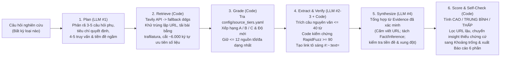

# Gamota · Hệ thống Nghiên cứu Thị trường Game có Căn cứ (Evidence-Grounded Market Research MVP)

**Mô tả 1 câu:** Công cụ nghiên cứu thị trường game tự động phân rã câu hỏi kinh doanh, thu thập và xếp hạng nguồn (`A/B/C`), ép buộc xác minh từng câu trích dẫn nguyên văn bằng thuật toán (`RapidFuzz >= 90`) kèm link tô sáng tận nguồn (`#:~:text=`), và tính điểm độ tin cậy (`CAO / TRUNG BÌNH / THẤP`) bằng quy tắc code tất định để hỗ trợ ra quyết định phát hành game tại Gamota.

- **Link Demo (Streamlit Cloud):** `https://gamota-market-research-mvp.streamlit.app` *(Hướng dẫn kích hoạt trong 2 phút từ repo public này tại mục 6; nếu ứng dụng đang ở trạng thái ngủ khi mở bằng trình duyệt ẩn danh, vui lòng bấm **"Yes, get this app back up!"** và chờ khoảng 1 phút)*
- **Link Source Code (GitHub Public):** [https://github.com/DuongNAD/gamota-market-research-mvp](https://github.com/DuongNAD/gamota-market-research-mvp)
- **Link Video Walkthrough (≤ 5 phút):** *(Cập nhật link video Loom / YouTube Unlisted / Google Drive trước khi bấm nộp form; kịch bản quay chi tiết từng giây nằm ở cuối file này và trong [`SUBMISSION.md`](SUBMISSION.md))*

---

## 2. Bài toán và người dùng mục tiêu

Đội ngũ phát hành game (Publishing, Business Development, Product Marketing) tại Gamota thường xuyên phải trả lời các câu hỏi nghiên cứu thị trường tốc độ cao: chọn thể loại game cho 12 tháng tới, chọn mô hình kiếm tiền (IAA / IAP / Hybrid), ước tính quy mô thị trường quốc gia hoặc kiểm tra số liệu đối thủ. Tuy nhiên, thông tin ngành game trên mạng vừa phân mảnh, vừa mâu thuẫn về định nghĩa (doanh thu nội địa vs. xuất khẩu, mobile vs. toàn ngành), lại thường khóa dữ liệu chi tiết sau paywall. Nếu hỏi thẳng các chatbot AI thông thường, người làm sản phẩm không dám dùng kết quả để trình duyệt ngân sách vì chatbot trộn lẫn số liệu thật với suy diễn, tự bịa URL và không cho biết nhận định nào đủ chắc chắn để hành động.

---

## 3. Phần chọn để chứng minh, vì sao, và khác biệt so với hỏi thẳng Chatbot có tìm kiếm

Trong khuôn khổ MVP, tôi không xây dựng một hệ thống thu thập dữ liệu đa kênh đồ sộ mà chọn chứng minh sâu **lớp "Nhận định có căn cứ" (Verified Evidence & Deterministic Confidence Layer)** với giả thuyết cốt lõi:

> Với **bất kỳ** câu hỏi nghiên cứu thị trường game nào, mỗi nhận định quan trọng đều phải: **(a)** truy về một trích dẫn nguyên văn (`<= 40` từ, giữ nguyên ngôn ngữ gốc) đã được code xác minh tồn tại trong văn bản nguồn (`rapidfuzz.fuzz.partial_ratio >= 90`), **(b)** gắn với hạng tin cậy (`A/B/C`) và độ mới của nguồn, và **(c)** có độ tin cậy (`CAO / TRUNG BÌNH / THẤP`) được tính bằng quy tắc code minh bạch (LLM không tự chấm điểm, không tự viết URL; thiếu dữ liệu thì nói rõ là thiếu).

**Vì sao chọn phần này?** Tìm kiếm web và viết bản tóm tắt mượt mà là việc bất kỳ chatbot nào cũng làm được trong vài giây; điểm nghẽn thực sự khiến người ra quyết định không dám tin vào AI nằm ở **khả năng kiểm chứng tận nguồn và định lượng sự bất định**. Nếu chứng minh được một kiến trúc ép buộc mọi nhận định đi qua bộ lọc đối khớp chuỗi nguyên văn và chấm điểm bằng code tất định, ta giải quyết được rủi ro cốt lõi nhất (ảo giác số liệu và ngụy tạo nguồn).

**Khác biệt thực nghiệm so với hỏi thẳng một Chatbot / LLM trần** (dữ liệu đối chiếu thực tế từ [`eval/results/baseline_raw_llm.json`](eval/results/baseline_raw_llm.json)):

| Tiêu chí | Hỏi thẳng Chatbot / LLM trần | Hệ thống MVP này (`Plan → Retrieve → Grade → Verify → Synthesize → Score`) |
|---|---|---|
| **URL & Trích dẫn** | Tự sinh URL từ trí nhớ (ở `TC3` tự bịa 3 link báo năm 2023 không kiểm chứng, `0` câu trích dẫn nguyên văn). | **Cấm LLM viết URL** (code lọc bỏ bằng regex nếu vi phạm: `llm_invented_urls_removed_count`). Mọi URL đều lấy từ bước `Retrieve` và do code tự gắn `# :~:text=` tô sáng đúng câu trích dẫn đã vượt ngưỡng `RapidFuzz >= 90`. |
| **Chấm điểm độ tin cậy** | LLM tự đánh giá cảm tính (ở `TC3` tự chấm `CAO` dù dùng số cũ 2023; ở `TC4` tự chấm `TRUNG BÌNH` cho con số tự đoán). | **100% tính bằng code (`research/score.py`)** dựa trên số lượng domain độc lập, hạng nguồn (`A/B/C`), độ mới (`<=12m / 12-24m / >24m`), loại nhận định (`fact` vs `inference`) và xung đột dữ liệu. |
| **Xử lý thiếu dữ liệu & tiền đề sai** | Ở `TC4` (MMORPG Campuchia 2025), LLM trần tự nhân tỷ lệ giả định để bịa ra con số `"3,5 đến 6 triệu USD"`. | Ở `TC4` và `TC6`, hệ thống từ chối bịa số, nói rõ khoảng trống dữ liệu ngay câu đầu tiên của `short_answer`, cung cấp số liệu proxy có trích dẫn và sắp xếp các bước kiểm chứng tiếp theo từ rẻ nhất đến đắt nhất. Ở `TC5`, bước `Premise Check` bác bỏ thẳng tiền đề sai ("giảm 50%"). |

---

## 4. Cách hoạt động: Sơ đồ Pipeline 6 bước & Quy tắc Hạng nguồn / Độ tin cậy

### 4.1 Sơ đồ kiến trúc Pipeline 6 bước



### 4.2 Quy tắc xếp hạng nguồn (`research/grade.py` & `config/source_tiers.yaml`)

- **Hạng A (Nguồn dữ liệu sơ cấp & Tổ chức đo lường ngành):** Các đơn vị đo lường telemetry ứng dụng/game hàng đầu (`sensortower.com`, `data.ai`, `newzoo.com`, `nikopartners.com`, `statista.com`, `appmagic.rocks`), cổng thông tin cơ quan quản lý nhà nước (`mic.gov.vn`, `game.gov.vn`, `most.gov.vn`) và trang quan hệ cổ đông (`ir.*`, `investor.*`).
- **Hạng B (Báo chí chuyên ngành & Nền tảng AdTech/Analytics có biên tập):** Báo chuyên ngành game/công nghệ và đơn vị đo lường quảng cáo uy tín (`gamesindustry.biz`, `pocketgamer.biz`, `gamedeveloper.com`, `appsflyer.com`, `adjust.com`, `singular.net`, `unity.com`, `vnexpress.net`, `vneconomy.vn`, `cafef.vn`, `forbes.com`, `bloomberg.com`, `reuters.com`).
- **Hạng C (Mặc định):** Các blog tổng hợp, trang tin thứ cấp, diễn đàn hoặc thông cáo báo chí chưa qua kiểm chứng độc lập (chỉ dùng để tham khảo chéo, **không bao giờ đủ điều kiện tạo nhận định độ tin cậy `CAO`**).
- **Độ mới của nguồn (so với ngày hệ thống chạy):**
  - `Mới (<= 12 tháng)` (`fresh`)
  - `Cũ dần (12–24 tháng)` (`aging`)
  - `Cũ (> 24 tháng hoặc không rõ ngày đăng)` (`stale`)

### 4.3 Quy tắc tính Độ tin cậy tất định bằng Code (`research/score.py`)

| Mức độ tin cậy | Điều kiện bắt buộc (kiểm tra bằng code trong `score_single_insight`) |
|---|---|
| **`CAO`** | Nhận định thuộc loại **Thực chứng (`type == "fact"`)**, không phải dự báo tương lai (`is_forecast == False`), không có mâu thuẫn (`has_conflict == False`), được chứng minh bởi **`>= 2` domain độc lập không cũ (`fresh/aging`)**, trong đó có **ít nhất 1 nguồn Hạng `A` hoặc `B` còn mới (`<= 12 tháng`)**, và không phải câu thông báo thiếu dữ liệu. |
| **`TRUNG BÌNH`** | Có **1 nguồn Hạng `A/B`** không cũ; **HOẶC** có **`>= 2` nguồn Hạng `C` khác domain** cùng đồng thuận (không cũ); **HOẶC** dữ liệu thuộc nhóm `Cũ dần (12–24 tháng)`. **Quy tắc trần:** Mọi nhận định **Suy luận (`inference`)** hoặc **Dự báo tương lai (`is_forecast`)** đều bị khóa trần tối đa ở mức **`TRUNG BÌNH`** và bắt buộc phải hiển thị giả định đi kèm (`assumptions`). |
| **`THẤP`** | Chỉ có **1 nguồn Hạng `C`** đơn lẻ; **HOẶC** toàn bộ nguồn dẫn chứng đều `Cũ (> 24 tháng / không rõ ngày)`; **HOẶC** các nguồn đang có số liệu mâu thuẫn chưa giải quyết (`has_conflict == True`). *(Lưu ý: Nhận định không có bất kỳ `evidence_id` hợp lệ nào sẽ bị code tự động loại khỏi bảng nhận định và chuyển thẳng xuống mục 4.1 Khoảng trống dữ liệu)*. |

---

## 5. Bảng ánh xạ Yêu cầu R1–R5 → Giải pháp trong MVP → Bằng chứng thực tế

| Mã | Yêu cầu cốt lõi (`BRIEF.md` mục 3) | Cách MVP đáp ứng | Bằng chứng kiểm chứng (Test ID / File kết quả) |
|---|---|---|---|
| **R1** | **Xử lý được nhiều loại câu hỏi nghiên cứu** (cơ hội thể loại, mô hình kiếm tiền, quy mô thị trường, đối thủ/doanh thu, kiểm tra tiền đề). | Bước 1 (`plan_research` trong [`research/synthesize.py`](research/synthesize.py)) tự động phân loại câu hỏi (`option_selection`, `market_sizing`, `premise_check`, `competitor_or_metric`), sinh tiêu chí ra quyết định phù hợp và lập bảng so sánh Phương án × Tiêu chí khi câu hỏi có nhiều lựa chọn. | 6 test case thuộc 4 nhóm câu hỏi khác nhau chạy trên cùng 1 pipeline: [`TC1`](eval/results/TC1.md) (thể loại), [`TC2`](eval/results/TC2.md) (kiếm tiền), [`TC3`](eval/results/TC3.md) & [`TC4`](eval/results/TC4.md) (quy mô), [`TC5`](eval/results/TC5.md) (tiền đề sai), [`TC6`](eval/results/TC6.md) (đối thủ/doanh thu). |
| **R2** | **Kết luận có căn cứ, truy được về nguồn gốc** (trích dẫn nguyên văn `<= 40` từ, kiểm chứng bằng code, link mở đúng đoạn văn bản gốc). | Hàm `verify_quote` trong [`research/extract.py`](research/extract.py) chuẩn hóa dấu câu Unicode và đối khớp `rapidfuzz.fuzz.partial_ratio >= 90` trên văn bản nguồn; hàm `build_text_fragment_url` tự tạo link `url#:~:text=...` để trình duyệt cuộn và tô sáng câu trích dẫn. | Unit tests [`tests/test_verify_quote.py`](tests/test_verify_quote.py) (7/7 pass); tỷ lệ xác minh trích dẫn đạt `100.0%` trên toàn bộ `TC1`–`TC6` (tổng cộng 166 câu trích dẫn nguyên văn đã xác minh). |
| **R3** | **Phân biệt độ tin cậy của nguồn** (`A/B/C`) và **độ mới của dữ liệu** (`<=12m`, `12-24m`, `>24m`). | [`config/source_tiers.yaml`](config/source_tiers.yaml) + [`research/grade.py`](research/grade.py) chấm hạng nguồn theo domain và ngày đăng (kèm fallback tách tháng/quý/năm từ URL slug & tiêu đề trong [`research/retrieve.py`](research/retrieve.py)). Nguồn Hạng C không bao giờ tạo được nhận định `CAO`. | Unit tests [`tests/test_grade.py`](tests/test_grade.py) (4/4 pass) & [`tests/test_score.py`](tests/test_score.py) (8/8 pass); chỉ số `high_confidence_from_tier_c_only_count = 0` trên toàn bộ 6 test case. |
| **R4** | **Chỉ ra khoảng trống dữ liệu, mâu thuẫn, tiền đề sai và bước kiểm chứng tiếp theo** (từ rẻ đến đắt). | Báo cáo đầu ra luôn có المục 3 (`Kiểm tra tiền đề` & `Mâu thuẫn số liệu`) và Mục 4 (`Khoảng trống dữ liệu`, `Điều kiện đảo chiều kết luận`, `Bước kiểm chứng tiếp theo`). Khi có mâu thuẫn số liệu, code tự động nối cảnh báo dải số liệu vào ngay `short_answer`. | [`TC3`](eval/results/TC3.md) (hiển thị nhiều mốc quy mô VN: `825M USD` vs `500M USD` vs `315M USD` xuất khẩu vs `1.100M USD`), [`TC4`](eval/results/TC4.md) (báo thiếu số liệu MMORPG Campuchia), [`TC5`](eval/results/TC5.md) (`BÁC BỎ` tiền đề giảm 50%), [`TC6`](eval/results/TC6.md) (báo thiếu dữ liệu tháng trước sau paywall). |
| **R5** | **Kiểm tra chất lượng có hệ thống** (chỉ số tự kiểm trên mỗi báo cáo + bộ test tự động `>= 5` case có `>= 1` case chưa đạt thật + vòng cải tiến Before → After). | Mỗi báo cáo tự động tính `QualityMetrics` (Mục 6); bộ kiểm thử tự động `pytest` (21 tests) và `python -m eval.run_eval` (6 test cases `TC1`–`TC6`), ghi nhận đầy đủ vòng cải tiến Before → After và so sánh với LLM trần. | [`TESTING.md`](TESTING.md), [`eval/cases.yaml`](eval/cases.yaml), [`eval/run_eval.py`](eval/run_eval.py), [`eval/results/before_summary.json`](eval/results/before_summary.json), [`eval/results/after_summary.json`](eval/results/after_summary.json). |

---

## 6. Hướng dẫn chạy thử (Online & Local)

### 6.1 Xem bản Demo Online (Streamlit Community Cloud)
- Truy cập: `https://gamota-market-research-mvp.streamlit.app`
- **Lưu ý khi mở lần đầu:** Nếu ứng dụng trên Streamlit Community Cloud đang ở trạng thái ngủ (sleep) do không có truy cập trong vài giờ, hãy bấm nút **"Yes, get this app back up!"** và chờ khoảng 45–60 giây để container khởi động lại.
- **Chế độ mặc định (`📦 Kết quả đã lưu`):** Mở lên dùng được ngay **mà không cần bất kỳ API key nào**. Bạn có thể bấm chọn 4 nút câu hỏi mẫu hoặc chọn toàn bộ 6 báo cáo chạy thật (`TC1`–`TC6`) trong danh sách thả xuống để kiểm tra bảng nhận định, bấm thử các link tô sáng `#:~:text=` và xem nhật ký từng bước của pipeline.

### 6.2 Chạy thử ở máy Local (Windows / macOS / Linux)

```bash
# Bước 1: Clone repository và di chuyển vào thư mục dự án
git clone https://github.com/DuongNAD/gamota-market-research-mvp.git
cd gamota-market-research-mvp

# Bước 2: Tạo môi trường ảo (virtual environment) và cài đặt thư viện
python -m venv .venv
# Trên Windows PowerShell:
.\.venv\Scripts\Activate.ps1
# Trên macOS / Linux:
# source .venv/bin/activate

pip install -r requirements.txt

# Bước 3: Tạo file cấu hình môi trường từ file mẫu
cp .env.example .env
# (Tùy chọn) Mở file .env và điền GEMINI_API_KEY miễn phí từ https://aistudio.google.com/app/apikey
# Nếu KHÔNG điền key, ứng dụng vẫn chạy hoàn chỉnh ở chế độ "📦 Kết quả đã lưu" với 6 báo cáo thực tế!

# Bước 4: Khởi chạy giao diện web Streamlit
python -m streamlit run app.py
```

### 6.3 Chạy qua dòng lệnh (CLI) và chạy bộ kiểm thử tự động

```bash
# Chạy 1 câu hỏi bất kỳ qua CLI (cần GEMINI_API_KEY trong .env)
python -m research.cli "Thể loại game mobile nào có tiềm năng tại Đông Nam Á trong 12 tháng tới?" --save data/cached_runs/custom_run

# Chạy 21 bài kiểm thử đơn vị (Unit Tests) & kiểm thử giao diện (AppTest) — không cần API key
pytest -v

# Chạy bộ đánh giá 6 test case thực nghiệm (hoặc chạy 1 case với --case TC3)
python -m eval.run_eval
python -m eval.run_eval --case TC3
```

---

## 7. Tóm tắt kết quả kiểm thử (`TC1`–`TC6`)

Chi tiết đầy đủ (bao gồm trích dẫn output từng case, bảng đối chiếu vòng cải tiến **Before → After** và so sánh với **LLM trần**) nằm tại **[`TESTING.md`](TESTING.md)**.

| ID | Nhóm kết quả thật | Kết quả | Trích dẫn xác minh | Thời gian | Điều học được (1 dòng) |
|---|---|---|---|---|---|
| **[TC1](eval/results/TC1.md)** | **Làm tốt** (Cơ hội thể loại) | **ĐẠT** | `30/30` (`100.0%`) | `82.46s` | Trần quy tắc giữ mọi dự báo 12 tháng tới ở mức `<= TRUNG BÌNH` kèm giả định rõ ràng và bảng so sánh 4 thể loại × 5 tiêu chí. |
| **[TC2](eval/results/TC2.md)** | **Làm tốt** (Mô hình kiếm tiền) | **ĐẠT** | `28/28` (`100.0%`) | `40.89s` | Pipeline tự thích ứng sang bài toán IAA vs IAP vs Hybrid tại Indonesia & Philippines mà không cần sửa code hay prompt riêng. |
| **[TC3](eval/results/TC3.md)** | **Khó** (Nguồn mâu thuẫn) | **ĐẠT** | `28/28` (`100.0%`) | `30.50s` | Ép code tự nối cảnh báo dải số liệu (`825M USD` 2025 vs `500M USD` 2024 vs `315M USD` xuất khẩu vs `1.100M USD` 2033) vào `short_answer` giúp người đọc không bị chốt nhầm 1 con số. |
| **[TC4](eval/results/TC4.md)** | **Khó** (Thiếu dữ liệu ngách) | **ĐẠT** | `29/29` (`100.0%`) | `68.43s` | Trong khi LLM trần tự bịa doanh thu MMORPG Campuchia là `"3,5–6 triệu USD"`, pipeline từ chối đoán mò và chỉ cung cấp số liệu proxy có trích dẫn (`131,44M USD` toàn ngành). |
| **[TC5](eval/results/TC5.md)** | **Khó** (Tiền đề sai) | **ĐẠT** | `31/31` (`100.0%`) | `33.80s` | Bước `Premise Check` giúp hệ thống `BÁC BỎ` thẳng giả định sai ("giảm 50%") và chỉ ra doanh thu ĐNÁ thực tế vẫn tăng trưởng (`5,4 tỷ USD`, `+13,8%/năm`). |
| **[TC6](eval/results/TC6.md)** | **Chưa đạt thật** (Giới hạn paywall) | **CHƯA ĐẠT** | `20/20` (`100.0%`) | `23.39s` | Dữ liệu doanh thu tháng 9/2026 của riêng top 3 game gacha tại Thái Lan bị khóa sau paywall Sensor Tower/AppMagic; hệ thống báo thiếu trung thực thay vì lấy số toàn cầu (`50,23M USD`) gắn nhầm cho Thái Lan. |

---

## 8. Trả lời 3 câu hỏi bắt buộc

### Câu 1: Phần quan trọng nhất bạn chọn để hiện thực hóa trong MVP là gì? Vì sao nếu phần này hoạt động, bạn tin rằng hướng giải quyết của mình là khả thi?
Tôi chọn hiện thực hóa sâu **lớp kiểm chứng bằng chứng nguyên văn và tính điểm độ tin cậy tất định bằng code** (`Extract & Verify` trong [`research/extract.py`](research/extract.py) kết hợp `Score` trong [`research/score.py`](research/score.py)). Cụ thể, thay vì để LLM vừa viết báo cáo vừa tự đính kèm link và tự đánh giá mức độ chắc chắn, tôi bắt buộc mọi nhận định phải trỏ về mã `evidence_id` chứa câu trích dẫn nguyên văn `<= 40` từ đạt điểm khớp chuỗi `rapidfuzz.fuzz.partial_ratio >= 90` ngay trên văn bản nguồn đã thu thập. Nếu phần này hoạt động trơn tru, tôi tin hướng giải quyết của mình hoàn toàn khả thi vì nó giải quyết tận gốc rào cản lớn nhất khiến các đội phát hành game không dám dùng AI cho nghiên cứu thị trường: **ảo giác số liệu (hallucination) và ngụy tạo nguồn**. Thực nghiệm trên cả 6 test case (`TC1`–`TC6`) cho thấy hệ thống đã xác minh thành công `166/166` (`100.0%`) câu trích dẫn nguyên văn, tạo link tô sáng trực tiếp `#:~:text=` mở đúng câu gốc trên trình duyệt, giữ số URL do LLM tự viết ở mức `0` và số nhận định `CAO` dựa trên nguồn hạng C ở mức `0`. Đặc biệt, khi đối chiếu trực tiếp với LLM trần ở `TC3` và `TC4` ([`eval/results/baseline_raw_llm.json`](eval/results/baseline_raw_llm.json)), lớp kiểm chứng này đã chặn đứng hành vi tự bịa 3 URL cũ ở `TC3` và tự nhân tỷ lệ giả định để bịa ra con số `"3,5 đến 6 triệu USD"` cho MMORPG Campuchia ở `TC4`.

### Câu 2: So với kế hoạch ở Mission 1, bạn đã thay đổi quyết định hoặc thiết kế nào? Điều gì trong quá trình làm khiến bạn thay đổi?
So với ý tưởng ban đầu ở Mission 1 về một hệ thống nghiên cứu thị trường đa tác tử (multi-agent) có cơ sở dữ liệu lưu trữ dài hạn và thu thập đa kênh, tôi đã thực hiện **4 thay đổi thiết kế quan trọng** (ghi nhận chi tiết tại [`DECISIONS.md`](DECISIONS.md)):
1. **Thu gọn phạm vi sang pipeline tuyến tính 6 bước bằng Python thuần** (không dùng LangChain/CrewAI, không dùng database) để dồn toàn bộ thời gian chứng minh độ tin cậy của từng nhận định.
2. **Bổ sung cơ chế xoay vòng key và tự động chuyển đổi model Flash dự phòng kèm `thinkingBudget=0` trong [`research/llm.py`](research/llm.py)**: Khi chạy thực tế ở P1, model mặc định `gemini-3.8-flash` đôi lúc trả về `HTTP 503 (Service Unavailable)` và `gemini-2.5-flash` bật chế độ suy nghĩ mặc định làm bước tổng hợp mất hơn 35 giây; việc tự động failover và tắt `thinkingBudget` đã kéo thời gian mỗi lệnh gọi LLM xuống ~2,7 giây (tổng thời gian chạy mỗi báo cáo còn `23–82s`).
3. **Mở rộng bộ tách ngày xuất bản dự phòng (`_extract_date_fallback`) và siết quy tắc chấm điểm `CAO` sau vòng chạy kiểm thử đầu tiên (Before → After)**: Ở lượt chạy Before của P3, có tới `3–8/12` bài báo ngành (`Sensor Tower`, `AppsFlyer`) thiếu thẻ HTML meta date nên bị gán nhầm thành nguồn cũ (`stale`), trong khi ở `TC6` một câu thông báo "không có dữ liệu" ghép 1 nguồn A mất ngày và 1 nguồn C mới lại bị chấm nhầm là `CAO`. Tôi đã bổ sung regex tách tháng/quý/năm từ URL slug & tiêu đề (giảm nguồn mất ngày ở `TC3`, `TC5` về `0/12`) và sửa [`research/score.py`](research/score.py) yêu cầu nguồn hạng A/B phải còn mới (`fresh`) mới được lên `CAO`.
4. **Ép code tự động nối cảnh báo dải số liệu mâu thuẫn vào ngay `short_answer` và escape ký tự `\$` khi xuất bảng**: Sau khi thấy `short_answer` ở lượt chạy Before của `TC3` chỉ nêu một con số `825 triệu USD` dù mục 3.2 có nhiều mốc khác nhau, và thấy ảnh chụp màn hình trình duyệt ở P2 bị lỗi hiển thị phông chữ KaTeX khi một ô bảng có hai dấu `$` (`$625 million`), tôi đã sửa [`research/score.py`](research/score.py) và [`research/pipeline.py`](research/pipeline.py) để xử lý triệt để bằng code.

### Câu 3: MVP hiện xử lý chưa tốt nhất ở tình huống nào? Theo bạn nguyên nhân nằm ở đâu và nếu có thêm thời gian bạn sẽ ưu tiên cải thiện điều gì?
MVP hiện xử lý chưa tốt nhất ở **các câu hỏi đòi hỏi số liệu đo lường (telemetry) giao cắt sâu theo `Quốc gia × Thể loại ngách × Tháng gần nhất`**, thể hiện rõ nhất ở **[`TC6`](eval/results/TC6.md)** (*"Doanh thu tháng trước của 3 game gacha top đầu Thái Lan là bao nhiêu?"* — kết quả **CHƯA ĐẠT**) và một phần ở **[`TC4`](eval/results/TC4.md)** (*"Doanh thu MMORPG mobile tại Campuchia năm 2025"*). Ở `TC6`, dù hệ thống thu thập được 12 nguồn và xác minh `20/20` câu trích dẫn về doanh thu gacha toàn cầu tháng 9/2026 (`Genshin Impact` `50,23 triệu USD`, `Honkai: Star Rail` `35,735 triệu USD` từ `game8.co`) cũng như quy mô thị trường game Thái Lan nói chung (`192 triệu USD` từ `6wresearch.com`), hệ thống vẫn không thể trả lời được con số doanh thu tháng 9/2026 của riêng top 3 game gacha tại Thái Lan. Nguyên nhân gốc rễ nằm ở **giới hạn của nguồn dữ liệu web mở**: các bảng số liệu doanh thu cấp độ từng tựa game theo từng quốc gia và từng tháng không được công bố dưới dạng bài viết HTML công khai mà nằm sau tường phí (paywall) hoặc trang dashboard dựng bằng JavaScript động (SPA) của Sensor Tower, AppMagic và Data.ai. Bên cạnh đó, công cụ trích xuất `trafilatura` hiện chỉ đọc HTML tĩnh và bỏ qua các báo cáo định dạng PDF chuyên sâu (như 3 file PDF báo cáo thị trường Việt Nam của `investgame.net` bị bỏ qua ở `TC3`). Nếu có thêm thời gian, tôi sẽ ưu tiên cải thiện theo thứ tự: **(1)** Tích hợp đầu đọc dữ liệu nội bộ (CSV/Excel export từ tài khoản Sensor Tower/AppMagic của Gamota) và parser PDF (`pypdf`/`pdfplumber`) vào bước `Retrieve` để tận dụng các báo cáo ngành dạng PDF; **(2)** Bổ sung cơ chế truy vấn vòng 2 (iterative search) tự động sinh thêm truy vấn chuyên biệt khi bước `Extract` phát hiện thiếu số liệu cho câu hỏi phụ chính.

---

## 9. Hạn chế đã biết và hướng cải thiện (theo thứ tự ưu tiên)

1. **Giới hạn trước dữ liệu khóa sau Paywall & trang SPA động (`TC6`, `TC4`):**
   - *Hạn chế:* Nguồn tìm kiếm web mở (`Tavily` / `ddgs`) và bộ cào HTML tĩnh (`trafilatura`) không lấy được bảng số liệu doanh thu tháng gần nhất theo từng quốc gia/tựa game nằm trong dashboard trả phí của Sensor Tower, AppMagic hay Data.ai.
   - *Hướng cải thiện (Ưu tiên #1):* Cho phép người dùng tải lên (upload) thêm file CSV/PDF báo cáo nội bộ của Gamota ngay trên giao diện Streamlit và đưa vào cùng luồng kiểm chứng trích dẫn `Extract & Verify` như một nguồn Hạng A.
2. **Bỏ qua nguồn tài liệu định dạng PDF trực tuyến (`TC3`):**
   - *Hạn chế:* Để đảm bảo thời gian phản hồi `< 90 giây`, bước `Retrieve` hiện đang bỏ qua các URL trỏ tới file `.pdf` (ví dụ ở `TC3` đã bỏ qua 3 báo cáo PDF của `investgame.net`).
   - *Hướng cải thiện (Ưu tiên #2):* Tích hợp `pypdf` để bóc tách văn bản từ các báo cáo PDF có dung lượng `< 5MB` thuộc các domain Hạng A/B.
3. **Độ trễ khi chạy Live qua nhiều bước tuần tự (`23s – 82s`):**
   - *Hạn chế:* Do phải thực hiện tìm kiếm, tải 12–18 trang web, gọi LLM trích xuất bằng chứng theo lô và tổng hợp báo cáo, mỗi lượt chạy Live mất trung bình 30–80 giây và phụ thuộc vào hạn mức RPM của gói Gemini Free Tier.
   - *Hướng cải thiện (Ưu tiên #3):* Chuyển bước gọi LLM `Extract` của từng lô 4 nguồn sang chạy bất đồng bộ song song (`asyncio.gather`) trên các API key khác nhau để rút ngắn tổng thời gian chạy Live xuống dưới 25 giây.

---

## Phụ lục nộp bài: Đoạn "Trình bày bài làm" & Kịch bản Video Walkthrough

*(Bản đầy đủ kèm checklist bước cuối cho người nộp nằm tại [`SUBMISSION.md`](SUBMISSION.md))*

### A. Đoạn "Trình bày bài làm" (dán trực tiếp vào form nộp bài — 1.163 ký tự, nằm chuẩn trong khung 600–1.200 ký tự)

```text
Tôi xây dựng Hệ thống Nghiên cứu Thị trường Game có Căn cứ (Gamota MVP) nhằm giải quyết rủi ro lớn nhất khi dùng AI nghiên cứu thị trường: ảo giác số liệu và ngụy tạo nguồn. Thay vì để LLM tự trả lời và tự chấm điểm, sản phẩm chạy pipeline 6 bước (Plan -> Retrieve -> Grade -> Extract & Verify -> Synthesize -> Score), ép mọi nhận định truy về trích dẫn nguyên văn <=40 từ được code xác minh (RapidFuzz >=90) kèm link tô sáng (#:~:text=), xếp hạng nguồn A/B/C và tính độ tin cậy (CAO/TRUNG BÌNH/THẤP) bằng code tất định.
Cách chạy: Mở link Demo Streamlit (chế độ Kết quả đã lưu chạy ngay không cần key với 6 báo cáo thật TC1-TC6) hoặc chạy local: `pip install -r requirements.txt` -> `streamlit run app.py` (`pytest` 21/21 pass, `python -m eval.run_eval`).
Quyết định chính: (1) Cấm LLM viết URL, khóa trần dự báo ở mức TRUNG BÌNH; (2) Tự động hiển thị dải số liệu mâu thuẫn ngay ở tóm tắt (TC3); (3) Bổ sung tách ngày đăng từ URL/tiêu đề và xoay vòng key/model Flash.
Hạn chế: (1) Nguồn mở không lấy được doanh thu tháng trước theo quốc gia sau paywall Sensor Tower/AppMagic (TC6 chưa đạt thật, báo thiếu thay vì bịa số); (2) Chưa đọc file PDF; (3) Chạy Live mất 23-82s.
```

### B. Kịch bản Video Walkthrough (Mục tiêu 4 phút 30 giây — `<= 5 phút`)

| Thời lượng | Màn hình cần quay | Lời nói (Voice-over gợi ý) |
|---|---|---|
| **`0:00 – 0:30`**<br>*(Bài toán)* | Mở trang chủ ứng dụng Streamlit hoặc phần đầu `README.md`. | *"Chào anh/chị hội đồng chấm thi Gamota. Khi đội Publishing hoặc BD cần nghiên cứu nhanh một thị trường hay thể loại game mới, thông tin trên mạng thường phân mảnh và mâu thuẫn. Nếu hỏi thẳng các chatbot AI thông thường, chúng rất hay trộn số liệu thật với suy diễn, tự bịa link báo cáo và tự nhận độ tin cậy cao khiến chúng ta không dám dùng để ra quyết định đầu tư."* |
| **`0:30 – 1:00`**<br>*(Phần chọn để chứng minh)* | Cuộn tới sơ đồ Mermaid Pipeline 6 bước và bảng quy tắc Độ tin cậy trong `README.md`. | *"Vì vậy, trong MVP này, em không làm dàn trải mà chọn chứng minh sâu lớp 'Nhận định có căn cứ' qua pipeline 6 bước. Mọi nhận định bắt buộc phải trỏ về câu trích dẫn nguyên văn tối đa 40 từ, được code kiểm chứng bằng RapidFuzz đạt từ 90 điểm trở lên, gắn với hạng nguồn A/B/C từ file cấu hình, và độ tin cậy CAO, TRUNG BÌNH, THẤP được tính 100% bằng code tất định — LLM tuyệt đối không được tự viết URL và không được tự chấm điểm."* |
| **`1:00 – 2:45`**<br>*(Demo 2 câu hỏi khác loại + Bấm mở 1 trích dẫn kiểm chứng tận nguồn)* | Quay giao diện Streamlit (`app.py`):<br>1. Bấm nút mẫu **🎯 Cơ hội thể loại (TC1)**, chỉ vào 4 thẻ chỉ số tự kiểm (`100%` trích dẫn xác minh, `0` CAO từ nguồn C), bảng Phương án × Tiêu chí và bảng Nhận định.<br>2. **Bấm trực tiếp vào link `[E2 · S2 (sensortower.com)]` ở nhận định `I1`** để mở tab mới trên trình duyệt, cho thấy trình duyệt tự cuộn tới và tô sáng câu trích dẫn *"In the first quarter of 2025, Southeast Asia ranked as the second-largest global market..."*.<br>3. Quay lại app, bấm sang **💰 Mô hình kiếm tiền (TC2)** để cho thấy cùng pipeline tự sinh bộ tiêu chí mới và phân tích IAA vs IAP vs Hybrid tại Indonesia & Philippines. | *"Trên giao diện ứng dụng, chế độ Kết quả đã lưu hoạt động ngay mà không cần API key. Với câu hỏi loại 1 (TC1) về thể loại game tiềm năng tại Đông Nam Á 12 tháng tới, hệ thống xác minh 30/30 câu trích dẫn nguyên văn, lập bảng so sánh 4 thể loại trên 5 tiêu chí, và khóa trần mọi nhận định dự báo ở mức TRUNG BÌNH kèm giả định. Em xin bấm thử vào link bằng chứng E2 của nguồn Hạng A Sensor Tower: trình duyệt mở trực tiếp bài báo gốc và tô sáng đúng câu nguyên văn tiếng Anh đã trích xuất. Khi chuyển sang câu hỏi loại 2 (TC2) về mô hình kiếm tiền game casual tại Indonesia và Philippines, cùng một pipeline tự động đổi bộ tiêu chí sang ARPU, tỷ lệ nhà phát hành dùng IAA (86%) và IAP (29%) mà không hề hardcode."* |
| **`2:45 – 3:45`**<br>*(Tình huống khó: TC3, TC4, TC5)* | Chọn lần lượt các báo cáo **`TC3`**, **`TC4`**, **`TC5`** trên dropdown của Streamlit (hoặc mở tab `TESTING.md` mục 4 & 5). Chỉ vào phần `Trả lời ngắn`, `Mâu thuẫn số liệu` và `Kiểm tra tiền đề`. | *"Ở các tình huống khó: Với TC3 về quy mô game mobile Việt Nam, thay vì chốt bừa một con số hay lấy trung bình cộng, hệ thống trình bày cả mốc 825 triệu USD năm 2025, 500 triệu USD năm 2024 và giải thích sự khác biệt giữa lượt tải nội địa (272 triệu) với sản lượng xuất khẩu toàn cầu của studio Việt (4,9 tỷ lượt tải). Với TC4 về doanh thu MMORPG Campuchia 2025, trong khi LLM trần tự bịa ra con số 3,5 đến 6 triệu USD, hệ thống của em nói rõ nguồn mở không có số liệu này, chỉ cung cấp số liệu proxy 131,44 triệu USD toàn ngành game Campuchia và gợi ý các bước kiểm chứng từ rẻ đến đắt. Với TC5 hỏi vì sao doanh thu Đông Nam Á giảm 50%, bước Premise Check bác bỏ thẳng tiền đề sai này bằng số liệu tăng trưởng thực tế."* |
| **`3:45 – 4:30`**<br>*(Hạn chế, Case chưa đạt thật TC6 & Bước tiếp theo)* | Chọn **`TC6`** trên giao diện Streamlit và mở phần cuối `TESTING.md` / `README.md`. | *"Về hạn chế và case chưa đạt thật: Ở TC6 hỏi doanh thu tháng trước (tháng 9/2026) của top 3 game gacha tại riêng Thái Lan, nguồn web mở chỉ có số liệu toàn cầu của Genshin Impact (50,23 triệu USD) và Honkai: Star Rail (35,735 triệu USD), còn bảng tách riêng theo quốc gia Thái Lan tháng gần nhất bị khóa sau paywall của Sensor Tower và AppMagic. Hệ thống đã trung thực báo thiếu dữ liệu thay vì lấy số toàn cầu gắn nhầm cho Thái Lan, và đánh dấu TC6 là Chưa đạt. Nếu có thêm thời gian, ưu tiên số 1 của em là cho phép upload file CSV/PDF xuất từ tài khoản Sensor Tower nội bộ của Gamota vào bước Retrieve, tiếp theo là đọc báo cáo PDF trực tuyến và song song hóa bước Extract để giảm thời gian chạy xuống dưới 25 giây. Em xin cảm ơn!"* |
